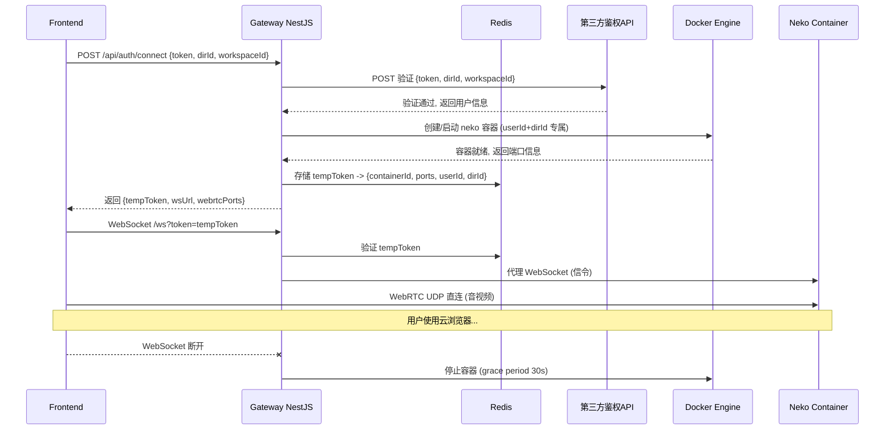

# Cloud Browser Gateway 实施方案

## 整体架构



## 技术栈

- **NestJS v11** + TypeScript
- **@nestjs/swagger**: Swagger/OpenAPI 接口文档自动生成
- **Dockerode**: Docker API 客户端，管理 neko 容器生命周期
- **ioredis**: Redis 客户端，存储临时 token 和会话映射
- **http-proxy**: HTTP/WebSocket 反向代理
- **axios**: 调用第三方鉴权接口
- **@nestjs/config**: 环境变量配置
- **crypto.randomUUID()**: Node.js 原生方法生成临时 token（不引入第三方 uuid 库）

## 目录结构

```
apps/cloud-browser-gateway/
├── package.json
├── tsconfig.json
├── tsconfig.build.json
├── nest-cli.json
├── .env.example
├── src/
│   ├── main.ts                          # 启动入口
│   ├── app.module.ts                    # 根模块
│   ├── config/
│   │   └── configuration.ts            # 环境变量配置
│   ├── auth/
│   │   ├── auth.module.ts
│   │   ├── auth.controller.ts          # POST /api/auth/connect
│   │   ├── auth.service.ts             # 鉴权逻辑 + token 签发
│   │   ├── auth.guard.ts               # 临时 token 校验守卫
│   │   └── dto/
│   │       └── connect.dto.ts          # { token, dirId, workspaceId }
│   ├── container/
│   │   ├── container.module.ts
│   │   ├── container.service.ts        # Docker 容器 CRUD
│   │   └── port-allocator.service.ts   # 端口池分配
│   ├── proxy/
│   │   ├── proxy.module.ts
│   │   ├── proxy.controller.ts         # HTTP 代理路由
│   │   └── proxy.gateway.ts            # WebSocket 代理 + 断连检测
│   └── redis/
│       ├── redis.module.ts
│       └── redis.service.ts            # Redis 封装
```

## 模块详细设计

### 1. AuthModule - 鉴权与 Token 签发

**`POST /api/auth/connect`** 接口

### 2. ContainerModule - Docker 容器管理

- 镜像：`ghcr.io/m1k1o/neko/chromium:latest`（可配置）
- Volume：`{DATA_DIR}/{userId}/{dirId}:/home/neko/.config/RoxyChrome`
- WebRTC 使用 `NEKO_WEBRTC_UDPMUX` 模式（单 UDP 端口）
- 容器断连后 30s grace period，超时停止+移除（volume 保留）

### 3. ProxyModule - 反向代理

- HTTP: `/api/neko/*` -> neko 容器 `/api/*`
- WebSocket: `/ws` -> neko 容器 `/ws`
- 单连接独占：`active_ws:{containerId}` Redis 锁，重复连接返回 close code `4001`

### 4. RedisModule - 数据存储

- `temp_token:{tempToken}`: 会话信息 (TTL 24h)
- `user_container:{userId}:{dirId}`: 用户+目录容器映射（复合唯一键）
- `allocated_ports:http/udp`: 已占用端口集合
- `active_ws:{containerId}`: WebSocket 连接独占锁
