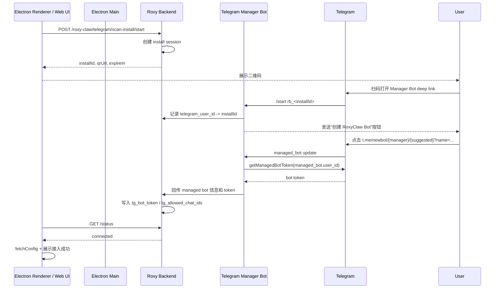

# Telegram Bot 扫码接入开发技术文档

> 本文档说明 RoxyBrowser / RoxyClaw 如何基于 Telegram Bot API 的 Managed Bots 能力，实现类似飞书/Lark 的“扫码接入 Telegram Bot”流程。
>
> 当前日期：2026-07-11。Telegram Bot API 仍在快速变化，正式开发前请以官方文档为最终依据：
>
> - Bot API: https://core.telegram.org/bots/api
> - Bot API changelog: https://core.telegram.org/bots/api-changelog
> - Bot deep linking: https://core.telegram.org/bots/features#deep-linking

---

## 1. 目标与结论

### 1.1 目标

当前 Telegram 接入需要用户手动完成：

1. 打开 BotFather。
2. 发送 `/newbot`。
3. 输入 Bot 名称和用户名。
4. 复制 Bot token。
5. 粘贴到 RoxyClaw 配置页。
6. 给 Bot 发送消息。
7. 打开 `getUpdates` 查找 `message.chat.id`。
8. 手动填入白名单。

新方案目标是：

1. 用户在 RoxyClaw Telegram 配置页扫描二维码。
2. 在 Telegram 中按提示创建一个由 Roxy 管理的 Bot。
3. 后端自动拿到新 Bot token。
4. 后端自动写入 `tg_bot_token`。
5. 后端自动将创建者 Telegram user id 写入 `tg_allowed_chat_ids`。
6. Electron / Web UI 轮询状态，成功后刷新配置并提示接入成功。

### 1.2 核心结论

Telegram 可以实现“接近飞书扫码”的接入体验，但实现方式不同：

- 飞书/Lark：扫码后通过开放平台返回 App ID / App Secret。
- Telegram：通过一个预先配置好的 **Manager Bot** 请求用户创建 **Managed Bot**，然后 Manager Bot 使用 `getManagedBotToken` 获取该 Managed Bot 的 token。

因此，Telegram 扫码接入必须有后端参与。Manager Bot token 不能放在 Electron 包里，也不能暴露给前端。

---

## 2. 官方能力说明

### 2.1 Managed Bots

Telegram Bot API 已支持 Managed Bots 相关能力：

- `getManagedBotToken`
  - 用于获取 managed bot 的 token。
  - 入参是 managed bot 的 `user_id`。
  - 成功返回 token 字符串。
- `replaceManagedBotToken`
  - 用于轮换 managed bot 的 token。
- `ManagedBotCreated`
  - 表示创建了一个由当前 bot 管理的 bot。
- `ManagedBotUpdated`
  - 表示 managed bot 的创建、token 更新或 owner 更新。
- `User.can_manage_bots`
  - 表示当前 bot 是否具备管理 bot 的能力。
- `https://t.me/newbot/{manager_bot_username}/{suggested_bot_username}?name={suggested_bot_name}`
  - 用于引导用户创建一个由指定 manager bot 管理的 bot。

### 2.2 关键限制

1. 必须先拥有一个 Roxy 官方 Manager Bot。
2. Manager Bot 需要在 BotFather 中开启 Bot Management Mode。
3. 后端必须监听 Manager Bot 的 updates。
4. `getManagedBotToken` 只能由 Manager Bot token 调用。
5. Electron 不能直接调用 `getManagedBotToken`，否则会泄露 Manager Bot token。
6. 直接扫码到 `t.me/newbot/...` 时，后端很难可靠关联 Roxy 用户和 Telegram 创建事件，因此建议先扫码进入 Manager Bot 的 deep link。

---

## 3. 推荐架构

### 3.1 总体架构



### 3.2 为什么不建议二维码直接指向 `t.me/newbot`

可用但不够稳：

```text
https://t.me/newbot/{manager_bot_username}/{suggested_bot_username}?name=RoxyClaw
```

问题：

1. 用户可能修改 suggested username。
2. Managed bot update 里不一定包含 Roxy 侧 installId。
3. 如果同一时间多个用户创建失败/重试，后端只能靠 suggested username 或时间窗口猜测归属。

推荐的两步法：

1. 二维码打开：

```text
https://t.me/{manager_bot_username}?start=rb_{installId}
```

2. Manager Bot 在聊天中发送创建链接：

```text
https://t.me/newbot/{manager_bot_username}/{suggested_bot_username}?name={suggested_bot_name}
```

这样后端可以先把 Telegram user id 和 Roxy install session 绑定起来，后续 `ManagedBotUpdated.user.id` 就可以稳定关联到 Roxy 用户。

---

## 4. 后端需要实现的内容

### 4.1 基础配置

新增后端环境变量：

```bash
TELEGRAM_MANAGER_BOT_TOKEN=123456789:xxxxx
TELEGRAM_MANAGER_BOT_USERNAME=RoxyClawManagerBot
TELEGRAM_MANAGER_WEBHOOK_SECRET=随机字符串
TELEGRAM_SCAN_INSTALL_TTL_SECONDS=600
TELEGRAM_SCAN_INSTALL_BASE_NAME=RoxyClaw
```

启动时校验：

1. 调用 `getMe`。
2. 确认 `ok === true`。
3. 确认 `result.is_bot === true`。
4. 确认 `result.username === TELEGRAM_MANAGER_BOT_USERNAME`。
5. 确认 `result.can_manage_bots === true`。

如果 `can_manage_bots` 不是 `true`，后端启动可以继续，但扫码接入接口必须返回明确错误：

```json
{
  "code": 40001,
  "msg": "Telegram Manager Bot 未开启 Bot Management Mode"
}
```

### 4.2 Manager Bot 一次性准备

运维或后端负责人需要完成：

1. 使用 BotFather 创建 Roxy 官方 Manager Bot。
2. 在 BotFather Mini App 中开启 Bot Management Mode。
3. 保存 Manager Bot token 到后端密钥系统。
4. 配置 webhook：

```http
POST https://api.telegram.org/bot{TELEGRAM_MANAGER_BOT_TOKEN}/setWebhook
Content-Type: application/json

{
  "url": "https://api.roxybrowser.com/telegram/manager/webhook",
  "secret_token": "{TELEGRAM_MANAGER_WEBHOOK_SECRET}",
  "allowed_updates": ["message", "managed_bot"]
}
```

说明：

- `secret_token` 会通过 `X-Telegram-Bot-Api-Secret-Token` 请求头回传，后端必须校验。
- 如果后端部署多实例，建议只使用 webhook，不建议多实例同时 long polling。

### 4.3 数据模型

建议新增一张表或 Redis session。考虑扫码流程短生命周期，推荐 Redis + DB 组合：

#### Redis session

Key：

```text
roxy:telegram_scan_install:{install_id}
```

Value：

```ts
interface TelegramScanInstallSession {
  installId: string
  roxyUserId: number
  workspaceId?: number
  status:
    | 'waiting_user'
    | 'waiting_create'
    | 'managed_bot_created'
    | 'token_fetched'
    | 'config_saved'
    | 'expired'
    | 'cancelled'
    | 'error'
  managerBotUsername: string
  suggestedBotUsername: string
  suggestedBotName: string
  qrUrl: string
  createUrl: string
  telegramUserId?: number
  telegramUsername?: string
  managedBotUserId?: number
  managedBotUsername?: string
  error?: string
  createdAt: string
  expiresAt: string
}
```

TTL 建议 10 分钟。

#### DB 审计表

```sql
CREATE TABLE telegram_scan_install_logs (
  id BIGINT PRIMARY KEY AUTO_INCREMENT,
  install_id VARCHAR(64) NOT NULL,
  roxy_user_id BIGINT NOT NULL,
  workspace_id BIGINT NULL,
  status VARCHAR(64) NOT NULL,
  telegram_user_id BIGINT NULL,
  telegram_username VARCHAR(128) NULL,
  managed_bot_user_id BIGINT NULL,
  managed_bot_username VARCHAR(128) NULL,
  error TEXT NULL,
  created_at DATETIME NOT NULL,
  updated_at DATETIME NOT NULL
);
```

不要把 managed bot token 明文写入日志。

### 4.4 后端 API

#### 4.4.1 发起扫码接入

```http
POST /api/roxy-claw/telegram/scan-install/start
Authorization: Bearer <roxy_user_token>
Content-Type: application/json

{
  "workspaceId": 123
}
```

返回：

```json
{
  "code": 0,
  "data": {
    "installId": "tgsi_01J...",
    "qrUrl": "https://t.me/RoxyClawManagerBot?start=rb_tgsi_01J...",
    "expireIn": 600,
    "managerBotUsername": "RoxyClawManagerBot",
    "suggestedBotUsername": "roxyclaw_123_ab12_bot"
  }
}
```

后端逻辑：

1. 校验用户登录态。
2. 生成 `installId`。
3. 生成唯一的 `suggestedBotUsername`。
4. 生成 `qrUrl`：

```text
https://t.me/{managerBotUsername}?start=rb_{installId}
```

5. 生成 `createUrl`：

```text
https://t.me/newbot/{managerBotUsername}/{suggestedBotUsername}?name=RoxyClaw
```

6. 写入 Redis session。
7. 返回二维码 URL。

#### 4.4.2 查询扫码状态

```http
GET /api/roxy-claw/telegram/scan-install/{installId}/status
Authorization: Bearer <roxy_user_token>
```

返回：

```json
{
  "code": 0,
  "data": {
    "status": "config_saved",
    "managedBotUsername": "roxyclaw_123_ab12_bot",
    "telegramUserId": "123456789",
    "expireIn": 520
  }
}
```

状态枚举：

| 状态 | 含义 | 前端文案建议 |
| --- | --- | --- |
| `waiting_user` | 等待用户扫码进入 Manager Bot | 请使用 Telegram 扫码 |
| `waiting_create` | 已识别用户，等待创建 Bot | 请在 Telegram 中点击创建按钮 |
| `managed_bot_created` | Telegram 已创建 Managed Bot | 正在获取 Bot token |
| `token_fetched` | 已拿到 token | 正在保存配置 |
| `config_saved` | 配置已保存 | 接入成功 |
| `expired` | 会话过期 | 二维码已过期，请重新生成 |
| `cancelled` | 用户取消 | 扫码接入已取消 |
| `error` | 失败 | 展示 error |

#### 4.4.3 取消扫码接入

```http
POST /api/roxy-claw/telegram/scan-install/{installId}/cancel
Authorization: Bearer <roxy_user_token>
```

返回：

```json
{
  "code": 0,
  "data": true
}
```

后端逻辑：

1. 校验 install session 属于当前用户。
2. 标记 `cancelled`。
3. 删除或缩短 Redis TTL。

### 4.5 Manager Bot webhook

接口：

```http
POST /api/telegram/manager/webhook
X-Telegram-Bot-Api-Secret-Token: <secret>
Content-Type: application/json
```

必须校验：

1. `X-Telegram-Bot-Api-Secret-Token`。
2. 请求体结构。
3. update 幂等处理。

#### 4.5.1 处理 `/start rb_{installId}`

伪代码：

```ts
async function handleManagerStart(update: TelegramUpdate) {
  const message = update.message
  const text = message?.text || ''
  const match = text.match(/^\/start\s+rb_(tgsi_[\w-]+)$/)
  if (!match)
    return

  const installId = match[1]
  const session = await sessionStore.get(installId)
  if (!session || session.status === 'expired')
    return sendMessage(message.chat.id, '二维码已过期，请回到 RoxyBrowser 重新生成。')

  session.telegramUserId = message.from.id
  session.telegramUsername = message.from.username
  session.status = 'waiting_create'
  await sessionStore.set(session)

  await sendMessage(message.chat.id, [
    '点击下方按钮创建 RoxyClaw Telegram Bot。',
    '创建完成后 RoxyBrowser 会自动保存配置。',
  ].join('\n'), {
    reply_markup: {
      inline_keyboard: [[
        { text: '创建 RoxyClaw Bot', url: session.createUrl },
      ]],
    },
  })
}
```

#### 4.5.2 处理 managed bot update

伪代码：

```ts
async function handleManagedBotUpdate(update: TelegramUpdate) {
  const managed = update.managed_bot || update.message?.managed_bot_created
  if (!managed)
    return

  const creatorUserId = managed.user?.id || update.message?.from?.id
  const managedBot = managed.bot
  if (!creatorUserId || !managedBot?.id)
    return

  const session = await sessionStore.findWaitingByTelegramUserId(creatorUserId)
  if (!session)
    return

  session.status = 'managed_bot_created'
  session.managedBotUserId = managedBot.id
  session.managedBotUsername = managedBot.username
  await sessionStore.set(session)

  const token = await telegramApi.getManagedBotToken(managedBot.id)
  session.status = 'token_fetched'
  await sessionStore.set(session)

  await saveRoxyClawTelegramConfig({
    roxyUserId: session.roxyUserId,
    workspaceId: session.workspaceId,
    tg_bot_token: token,
    tg_allowed_chat_ids: [String(creatorUserId)],
  })

  session.status = 'config_saved'
  await sessionStore.set(session)

  await sendMessage(creatorUserId, 'RoxyClaw Telegram Bot 接入成功，现在可以回到 RoxyBrowser 使用。')
}
```

实际字段名必须以 Telegram Bot API 返回为准。开发时需要在测试环境打印一次完整 update，确认 `managed_bot` / `managed_bot_created` 的实际位置。

### 4.6 写入 RoxyClaw 配置

当前项目配置字段：

```ts
tg_bot_token: string
tg_allowed_chat_ids: string[]
```

后端在 `config_saved` 阶段写入：

```ts
{
  tg_bot_token: managedBotToken,
  tg_allowed_chat_ids: [String(telegramUserId)]
}
```

注意：

1. `telegramUserId` 可以作为 Telegram 私聊 chat id 使用。
2. 如果后续支持群组，需要单独增加“把 Bot 拉入群并授权群 chat id”的流程。
3. 如果已有 `tg_allowed_chat_ids`，建议用 Set 合并，不要覆盖用户已有白名单，除非产品明确要求扫码重新接入会覆盖。
4. token 建议加密存储。如果现有字段暂时是明文，至少不要写入日志。

### 4.7 安全要求

必须做到：

1. Manager Bot token 只存在后端密钥系统。
2. Electron / Web UI 永远拿不到 Manager Bot token。
3. Managed bot token 尽量也不返回给前端，由后端直接写入配置。
4. Webhook 校验 `X-Telegram-Bot-Api-Secret-Token`。
5. `installId` 必须有 TTL。
6. 查询状态必须校验 Roxy 用户身份和 install session 归属。
7. 回调处理必须幂等。
8. 日志中禁止打印 bot token。
9. 失败重试时不要重复覆盖已成功保存的配置。

---

## 5. Electron / 前端需要实现的内容

### 5.1 推荐接入方式

推荐让 `apps/web` 通过业务后端 API 直接发起 Telegram 扫码接入，不建议 Electron Main 直接调用 Telegram Bot API。

原因：

1. Electron 不应持有 Manager Bot token。
2. Web UI 已经通过 `@roxy/backend-api` 管理 RoxyClaw 配置。
3. 后端需要维护扫码 session、webhook 和 token 保存，Electron 只负责展示二维码和轮询状态。

Electron Main 只在两种情况下需要新增 IPC：

1. 产品希望所有 IM 扫码流程都通过 `mcp:*` IPC 统一封装。
2. 后端 API 只能由 Electron Main 通过特定网络/proxy 访问。

### 5.2 前端 Store 新增类型

文件：

```text
apps/web/src/stores/roxy-claw.ts
```

新增类型：

```ts
export type TelegramScanInstallStatus =
  | 'waiting_user'
  | 'waiting_create'
  | 'managed_bot_created'
  | 'token_fetched'
  | 'config_saved'
  | 'expired'
  | 'cancelled'
  | 'error'

export interface TelegramScanInstallStartResult {
  success: boolean
  message?: string
  data?: {
    installId: string
    qrUrl: string
    expireIn: number
    managerBotUsername: string
    suggestedBotUsername: string
  }
}

export interface TelegramScanInstallStatusResult {
  success: boolean
  message?: string
  data?: {
    status: TelegramScanInstallStatus
    managedBotUsername?: string
    telegramUserId?: string
    expireIn?: number
    error?: string
  }
}
```

新增 store 方法：

```ts
async function startTelegramScanInstall(): Promise<TelegramScanInstallStartResult> {
  const res = await API.base.telegramScanInstallStart()
  return normalizeBackendResponse(res)
}

async function getTelegramScanInstallStatus(installId: string): Promise<TelegramScanInstallStatusResult> {
  const res = await API.base.telegramScanInstallStatus(installId)
  return normalizeBackendResponse(res)
}

async function cancelTelegramScanInstall(installId: string): Promise<{ success: boolean, message?: string }> {
  const res = await API.base.telegramScanInstallCancel(installId)
  return normalizeBackendResponse(res)
}
```

成功后：

```ts
await fetchConfig()
connectionStatus.value.telegram = { checked: true, status: 'success' }
```

如果后端没有直接写配置，而是返回 `connectionTicket`，则需要再增加：

```ts
async function completeTelegramScanInstall(ticket: string) {
  const res = await API.base.telegramScanInstallComplete({ ticket })
  await fetchConfig()
  connectionStatus.value.telegram = { checked: true, status: 'success' }
  return res
}
```

不推荐把 raw bot token 返回前端。

### 5.3 OpenAPI 客户端

后端接口加到 Apifox / OpenAPI 后，需要执行：

```bash
pnpm openapi
```

影响包：

```text
packages/backend-api
```

如果后端接口属于 agent backend，则执行：

```bash
pnpm openapi:agent
```

本功能更像主产品配置能力，应优先放在 main product backend spec，也就是 `pnpm openapi`。

### 5.4 Telegram 配置页 UI

文件：

```text
apps/web/src/views/roxy-claw/telegram-config.vue
```

当前页面使用 `ConfigBase` + 手动表单。新方案建议与 Lark / WeChat 保持一致：

1. 使用 `compare-versions` 判断 app 版本。
2. 新版本走扫码模式。
3. 老版本保留当前 BotFather 手动配置。
4. 扫码模式布局按 `wechat-config.vue` 的模式写，不自造额外样式。

版本判断建议：

```ts
import { compare } from 'compare-versions'
import { useUserStore } from '/@/stores/user'

const TELEGRAM_SCAN_MIN_VERSION = '3.9.2'
const userStore = useUserStore()

const useScanMode = computed(() => {
  const appVersion = userStore.appVersion || globalThis.$appVersion || '0.0.0'
  try {
    return compare(appVersion, TELEGRAM_SCAN_MIN_VERSION, '>')
  }
  catch {
    return false
  }
})
```

如果产品希望避免和 Lark 同版本混在一起，也可以改为：

```ts
const TELEGRAM_SCAN_MIN_VERSION = '3.9.3'
```

### 5.5 扫码模式状态

Telegram 页面新增本地状态：

```ts
const scanLoading = ref(false)
const scanPolling = ref(false)
const scanQrImageUrl = ref('')
const scanInstallId = ref('')
const scanQrExpired = ref(false)
const scanCompleted = ref(false)
const scanStatusText = ref('')
let scanPollTimer: ReturnType<typeof setTimeout> | null = null
```

进入新模式后：

1. 调用 `startTelegramScanInstall()`。
2. 使用 `qrcode` 生成二维码图片。
3. 轮询 `getTelegramScanInstallStatus()`。
4. 状态为 `config_saved` 时：
   - 停止轮询。
   - `await roxyClawStore.fetchConfig()`。
   - 设置 `connectionStatus.telegram = { checked: true, status: 'success' }`。
   - 如果 RoxyClaw 已启用，提示正在重启。

状态文案建议：

```ts
function getTelegramScanStatusText(status: TelegramScanInstallStatus) {
  if (status === 'waiting_user')
    return $t('请使用 Telegram 扫码')
  if (status === 'waiting_create')
    return $t('请在 Telegram 中点击创建 RoxyClaw Bot')
  if (status === 'managed_bot_created')
    return $t('Bot 已创建，正在获取 Token')
  if (status === 'token_fetched')
    return $t('正在保存配置')
  if (status === 'config_saved')
    return $t('扫码接入成功')
  if (status === 'expired')
    return $t('二维码已过期，请重新生成')
  if (status === 'cancelled')
    return $t('扫码接入已取消')
  return $t('扫码接入失败')
}
```

### 5.6 UI 结构

扫码模式建议复用 `wechat-config.vue` 的布局骨架：

```vue
<ConfigBase
  :title="$t('集成到 Telegram Bot')"
  :icon="getImage('roxy-claw/telegram.svg')"
  bg-color="#44b6ef"
  not-action-buttons
>
  <div class="flex flex-col gap-16 items-center">
    <div class="flex flex-col gap-16 items-center w-[714px]">
      <div class="font-bold text-[16px] text-[var(--colors-text-text-primary)] text-center w-full">
        {{ $t('使用 Telegram 扫描下方二维码，接入 RoxyClaw Bot。') }}
      </div>

      <!-- QR Code -->
      <!-- Step guide -->
    </div>

    <div v-if="isTelegramConfigured" class="flex gap-[10px] justify-end w-full">
      <RxButton severity="danger" size="md" :label="$t('删除配置')" @click="handleDelete" />
    </div>
  </div>
</ConfigBase>
```

老模式保留当前：

```vue
<ConfigBase
  v-else
  :steps="steps"
  :setup-fields="setupFields"
  @update:field-value="handleFieldUpdate"
  @test="handleTest"
  @save="handleSave"
  @delete="handleDelete"
/>
```

### 5.7 Electron IPC 可选方案

如果要通过 Electron Main 统一封装，需要增加 IPC，但 IPC 只调用 Roxy 后端，不调用 Telegram 官方 API。

#### Preload 类型

文件：

```text
apps/preload/src/types/renderMessage.ts
```

新增：

```ts
'mcp:startTelegramScanInstall': () => Promise<McpResponse<{
  installId: string
  qrUrl: string
  expireIn: number
  managerBotUsername: string
  suggestedBotUsername: string
}>>

'mcp:getTelegramScanInstallStatus': (installId: string) => Promise<McpResponse<{
  status: TelegramScanInstallStatus
  managedBotUsername?: string
  telegramUserId?: string
  expireIn?: number
  error?: string
}>>

'mcp:cancelTelegramScanInstall': (installId: string) => Promise<McpResponse>
```

#### Electron Main

文件：

```text
apps/electron/src/modules/ipc/receiver/modules/mcp.ts
```

新增 handler：

```ts
ipcMain.on('mcp:startTelegramScanInstall', async (_event) => {
  return roxyBackendFetch('/api/roxy-claw/telegram/scan-install/start', {
    method: 'POST',
    auth: true,
  })
})

ipcMain.on('mcp:getTelegramScanInstallStatus', async (_event, installId: string) => {
  return roxyBackendFetch(`/api/roxy-claw/telegram/scan-install/${installId}/status`, {
    method: 'GET',
    auth: true,
  })
})

ipcMain.on('mcp:cancelTelegramScanInstall', async (_event, installId: string) => {
  return roxyBackendFetch(`/api/roxy-claw/telegram/scan-install/${installId}/cancel`, {
    method: 'POST',
    auth: true,
  })
})
```

注意：

- 不要在 Electron 中保存 `TELEGRAM_MANAGER_BOT_TOKEN`。
- 不要在 IPC 返回 managed bot token。
- 如果使用 Electron IPC，仍然需要后端完成 session 和 webhook。

---

## 6. Agent / RoxyClaw 运行时影响

当前运行时读取：

```text
TELEGRAM_BOT_TOKEN=data?.tg_bot_token
TELEGRAM_ALLOWED_CHAT_IDS=data?.tg_allowed_chat_ids
```

相关文件：

```text
packages/roxy-agent/src/im/index.ts
packages/roxy-agent/src/im/telegram/adapter.ts
```

如果后端最终仍写入现有字段：

```ts
tg_bot_token
tg_allowed_chat_ids
```

则 agent 运行时无需改动。

成功保存配置后，现有 `roxyClawStore.updateConfig()` 会触发 RoxyClaw 重启。若后端直接写配置而前端只 `fetchConfig()`，需要确认后端是否会通知 Electron 重启 RoxyClaw。

推荐前端在扫码成功后调用现有重启逻辑之一：

1. 如果 store 有公共 `restartRoxyClaw()`，直接调用。
2. 否则复用一次 `updateConfig({ tg_bot_token, tg_allowed_chat_ids })` 不推荐，因为 token 不应回前端。
3. 更好的方式是新增后端保存配置后，前端调用 Electron IPC：

```ts
await roxyClawStore.restartRoxyClaw()
```

如果当前 store 没有公开 restart 方法，需要补一个只负责重启的 action。

---

## 7. 错误处理

### 7.1 后端错误码建议

| code | 含义 |
| --- | --- |
| `0` | 成功 |
| `40001` | Manager Bot 未启用 Bot Management Mode |
| `40002` | 扫码会话不存在或已过期 |
| `40003` | 扫码会话不属于当前用户 |
| `40004` | Telegram webhook secret 校验失败 |
| `40005` | 未收到 managed bot 创建事件 |
| `40006` | 获取 managed bot token 失败 |
| `40007` | 保存 RoxyClaw 配置失败 |
| `40008` | Telegram API 限流 |

### 7.2 前端错误策略

1. `expired`：二维码置灰，显示“重新生成”。
2. `cancelled`：停止轮询，提示已取消。
3. `error`：二维码置灰，显示后端 error。
4. 网络错误：继续轮询 2-3 次，之后提示网络错误。
5. 成功后：停止轮询，刷新配置，回到接入成功状态。

---

## 8. 兼容旧模式

老版本继续保留手动配置。

建议规则：

```text
appVersion > 3.9.2  => Telegram 扫码接入
appVersion <= 3.9.2 => BotFather 手动配置
```

如果 Telegram 后端上线时间晚于 Lark，可以使用更高版本门槛：

```text
appVersion > 3.9.3  => Telegram 扫码接入
appVersion <= 3.9.3 => BotFather 手动配置
```

产品发布前需要确认最终版本门槛。

---

## 9. 测试清单

### 9.1 后端

- [ ] Manager Bot `getMe` 返回 `can_manage_bots: true`。
- [ ] `start` 接口能创建 install session。
- [ ] 二维码 URL 能打开 Manager Bot。
- [ ] `/start rb_{installId}` 能绑定 Telegram user id。
- [ ] Manager Bot 能发送创建按钮。
- [ ] 用户点击按钮后能创建 managed bot。
- [ ] 后端能收到 managed bot update。
- [ ] 后端能调用 `getManagedBotToken`。
- [ ] 后端不会打印 token。
- [ ] 后端能写入 `tg_bot_token`。
- [ ] 后端能写入创建者 `tg_allowed_chat_ids`。
- [ ] status 接口能从 `waiting_user` 走到 `config_saved`。
- [ ] 过期 session 返回 `expired`。
- [ ] cancel 后 status 返回 `cancelled` 或 session 不可继续。

### 9.2 Electron / Web UI

- [ ] 新版本只展示扫码模式。
- [ ] 老版本仍展示 BotFather 手动配置。
- [ ] 页面进入后自动生成二维码。
- [ ] 二维码过期后可重新生成。
- [ ] 成功后显示“接入成功”。
- [ ] 成功后 `fetchConfig()` 能拿到新 token 对应的配置状态。
- [ ] 成功后 RoxyClaw 重启或下次启动能使用新 Telegram Bot。
- [ ] 删除配置仍能清空 `tg_bot_token` 和 `tg_allowed_chat_ids`。

### 9.3 Agent

- [ ] RoxyClaw 启动时 Telegram adapter 能通过 `getMe`。
- [ ] 白名单中的 Telegram 用户能收到回复。
- [ ] 非白名单用户收到未授权提示。
- [ ] `/new`、`/clear`、`/status` 等现有命令不受影响。

---

## 10. 建议实施顺序

1. 后端创建 Manager Bot 并开启 Bot Management Mode。
2. 后端实现 webhook 和 session。
3. 后端实现 start/status/cancel API。
4. 后端接入 `getManagedBotToken` 并写入 RoxyClaw 配置。
5. 更新 OpenAPI 并执行 `pnpm openapi`。
6. Web store 增加 Telegram scan install 方法。
7. `telegram-config.vue` 增加版本门槛和扫码 UI。
8. 成功后补齐 RoxyClaw 重启逻辑。
9. 灰度上线，保留旧手动配置入口作为降级。

---

## 11. 风险与待确认事项

1. **Bot Management Mode 开通方式**
   - 需要运维在 BotFather Mini App 中确认并开启。
   - 后端以 `getMe.can_manage_bots` 作为运行时校验。

2. **Managed Bot update 的实际字段**
   - 官方文档描述了 `ManagedBotCreated` / `ManagedBotUpdated`，但不同 SDK 的字段映射可能不同。
   - 第一次联调时必须保存脱敏后的原始 update 样本。

3. **用户修改 suggested username**
   - 推荐二维码先进入 Manager Bot deep link，通过 Telegram user id 关联 session。
   - 不建议只靠 suggested username 关联。

4. **token 保存方式**
   - 现有 RoxyClaw 配置字段可能是明文。
   - 新实现至少要禁止日志输出，后续应考虑加密存储。

5. **群组使用**
   - 本方案自动授权的是创建者私聊 user id。
   - 群组 chat id 仍需后续单独设计“添加群授权”流程。

6. **Electron 版本门槛**
   - Lark 当前用 `> 3.9.2`。
   - Telegram 是否同门槛需要产品确认。

