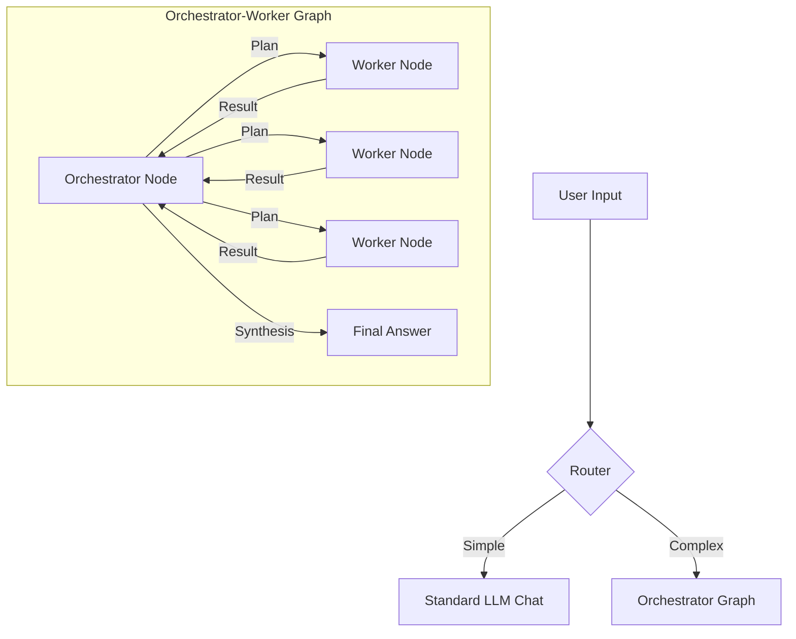

# Orchestrator-Worker Architecture Design

This document details the architectural design and implementation of the **Orchestrator-Worker** pattern integrated into this CLI application using **LangGraph.js**.

## 1. High-Level Concept

The system moves beyond simple interactions by creating an **Agentic Workflow** that "thinks before acting" and "divides and conquers."

### The Flow


## 2. Directory Structure

A simplified, MVP-friendly structure:

```text
src/
├── agent/                  # Core Orchestrator Logic
│   ├── index.ts            # LangGraph definition
│   ├── orchestrator.ts     # Main planning/synthesis node
│   ├── state.ts            # Graph state definition
│   └── workers/            # Worker nodes
├── chat/                   # Chat Management
│   ├── ChatManager.ts      # Main chat controller
│   ├── Router.ts           # intent classification (simple/orchestrator)
│   └── StreamHandler.ts    # Base LLM stream parser
├── cli/                    # CLI Interface
│   ├── Interface.ts        # Readline loop & commands
│   └── orchestrator/       # New streaming UI components
├── lib/                    # Adapters & Utilities
│   ├── OpenRouterChat.ts   # Custom connection to OpenRouter
│   └── MemoryManager.ts    # Conversation history
└── config/                 # Configuration
    └── config.ts           # Environment & LLM setup
```

## 3. Phase Design & Implementation

The architecture is divided into three distinct phases, coordinated by `OrchestratorStreamHandler`.

### 2.1 Planning Phase
**Goal**: Analyze request and generate a structured JSON plan with discrete subtasks.

- **Streaming Implementation**:
    - **Mental Sandbox (Thinking)**: We extract "Thought/Reasoning" blocks from the LLM *before* the plan is generated. 
    - **Custom Event Stream**: Due to standard event filtering, we emit a custom `reasoning_chunk` event from the generic LLM wrapper (`OpenRouterChat`) to ensure reasoning streams in real-time.
    - **Structure**:
        1. `[Planning] Thinking:` (Streams in Gray) - User sees the agent reasoning.
        2. `Drafting Plan...` (Streams in Dim White) - User sees the JSON plan forming.

### 2.2 Worker Phase (Parallel Execution)
**Goal**: Execute all subtasks in parallel to maximize efficiency.

- **Implementation**:
    - **Fan-Out**: The Orchestrator uses LangGraph's `Send` API to spawn independent worker nodes for each task in the plan.
    - **Visualization**: We use `Listr2` to render a dynamic, parallel task list.
    - **State Isolation**: Each worker runs in its own context, preventing cross-contamination of task data.

### 2.3 Synthesis Phase
**Goal**: Consolidate worker results into a final answer.

- **Synchronization**:
    - Critical sync point: We strictly `await` the completion of the Worker Phase (`Listr2` tasks) before starting the Synthesis display. This prevents UI fragmentation (fighting for `stdout`).
- **Streaming**:
    - Includes a final `Thinking:` block (gray) where the agent reflects on the gathered data.
    - Streams the `Final Answer` token-by-token.

## 4. Core Components

### 3.1 The Graph State (`src/agent/state.ts`)
We use `Annotation.Root` to persist state across the graph:
- `messages`: Full conversation history.
- `plan`: The calculated steps.
- `worker_results`: Array of outputs from workers (append-only reducer).
- `final_answer`: The ultimate response.

### 3.2 The Orchestrator Node (`src/agent/orchestrator.ts`)
Acts as the central manager with dual roles:
1.  **Planner**: Activated when `plan` is empty. Generates the Plan.
2.  **Synthesizer**: Activated when `worker_results` are ready. Generates the Final Answer.

### 3.3 Routing Logic
- **Router**: Lightweight LLM call ("Simple" vs "Complex") to determine if the Graph is needed.
- **RouteOrchestrator**: Conditional edge within the graph to decide between "Send to Workers" or "End".

## 5. UI/UX Philosophy
- **Transparency**: The user should see the process (Thinking -> Planning -> Working -> Synthesizing).
- **Responsiveness**: "Thinking" blocks stream immediately via Custom Events to prevent "frozen" states.
- **Clarity**: distinct visual styles (Gray for thoughts, Cyan for system status, White for content).
