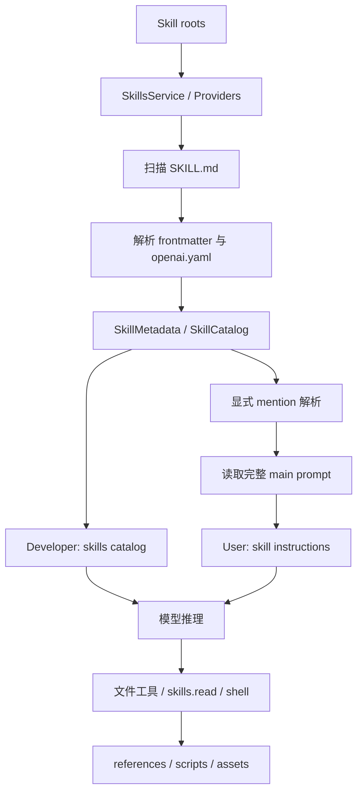
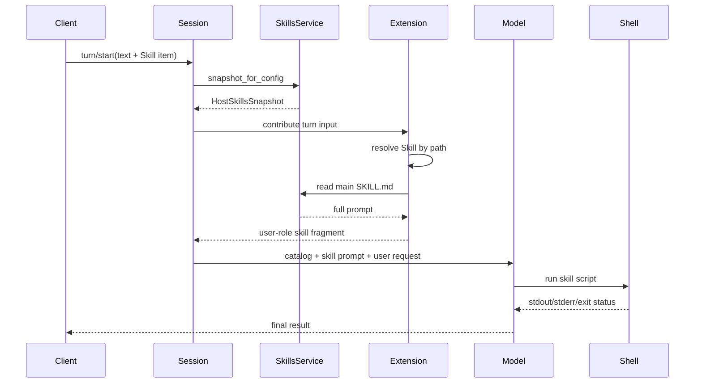
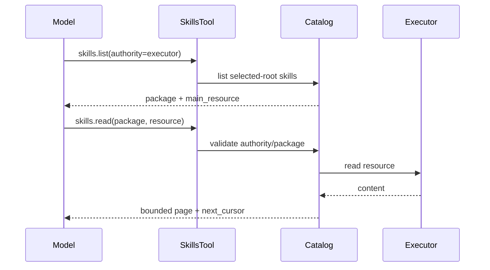

# Codex Skills 实现原理与开发指南

本文从源码层面解释 Codex 如何发现、解析、展示、选择、加载和执行 Skills，并说明 Skills 如何进入模型上下文、如何访问本地或远程资源、如何与脚本执行和 sandbox 配合。

本文不是对公开产品文档的改写，而是对当前 Codex 实现的工程解剖。分析基于：

- Codex 源码仓库：`/Users/macos/Projects/codex`
- 源码提交：`4c43465133428898aa84f0bfc02c306ed65fb66a`
- 分析日期：2026-07-25
- 官方概念入口：[Codex Skills](https://developers.openai.com/codex/skills)

本文的实现结论以固定提交的本地源码为准，官方链接只作为公开概念补充。文中引用的路径均相对于 Codex 仓库根目录，除非特别说明。

---

## 1. 结论摘要

Codex Skills 不是一组在启动时注册成函数的插件，也不是一个独立脚本运行时。它的核心是一个带有分层资源的、可渐进披露的指令包：

```text
Skill = 路由元数据 + 主指令 + 按需资源 + 可选脚本/资产
```

Codex 的关键设计是：

1. 启动或配置加载时扫描 Skills，但只把 `name`、`description` 和资源定位符组成目录放入模型上下文。
2. 用户显式选择 Skill 时，运行时读取完整主指令并作为一个独立上下文片段注入。
3. 没有显式选择时，模型根据目录中的 description 判断是否需要 Skill，并通过文件工具或 `skills.read` 按需读取。
4. `references/`、`scripts/`、`assets/` 不会因为存在就自动进入上下文。
5. `scripts/` 中的脚本仍通过普通 shell/exec 工具执行，使用同一套权限、审批、网络和 sandbox 机制。
6. 本地、执行环境和编排器 Skills 使用统一 Catalog 表示，但读取方式由资源所有者决定。
7. 上下文大小有硬预算，Skill 列表、description、主 prompt 和资源读取均有截断或分页规则。

最值得注意的一点是：Codex 没有一个通用的本地 `invoke_skill` 工具。Host Skill 通常通过完整 prompt 注入或普通文件读取使用；只有 executor/orchestrator 等非本地资源需要 `skills.list` 和 `skills.read`。

---

## 2. 总体架构

Skills 相关实现分散在几个职责明确的 crate 中：

| 模块                   | 主要职责                                                                                 |
| ---------------------- | ---------------------------------------------------------------------------------------- |
| `codex-rs/skills`      | 通用 Skill 数据类型、内置 Skill 资产、系统 Skill 安装                                    |
| `codex-rs/core-skills` | Host Skill 的扫描、解析、缓存、目录渲染、显式注入和命令归因                              |
| `codex-rs/ext/skills`  | 统一 Host、Executor、Orchestrator Provider，提供 Catalog、远程读取工具和 WorldState 集成 |
| `codex-rs/core`        | 会话初始化、turn 输入组装、模型请求、shell 工具和权限系统                                |
| `codex-rs/app-server`  | Skills JSON-RPC API、配置写入、额外 roots、文件监听与变更通知                            |
| `codex-rs/exec-server` | 执行环境文件系统、能力发现和远程资源读取                                                 |

端到端结构如下：



这里存在两个相互兼容的实现层：

- `core-skills` 是 Host filesystem Skills 的基础实现和兼容链路。
- `ext/skills` 是新的统一扩展层，把 Host、Executor、Orchestrator Skills 投影成同一个 Catalog，并避免旧链路重复注入。

`ext/skills` 在 turn store 中写入标记，例如 `HostSkillsCatalogInWorldState` 和 `InjectedHostSkillPrompts`，让 `core` 知道某些目录或完整正文已经由扩展注入，从而跳过重复内容。

---

## 3. Skill 包格式

### 3.1 标准目录结构

一个典型 Skill 目录为：

```text
my-skill/
├── SKILL.md
├── agents/
│   └── openai.yaml
├── references/
│   ├── api.md
│   └── examples.md
├── scripts/
│   ├── run.py
│   └── validate.sh
└── assets/
    └── template.json
```

只有 `SKILL.md` 是发现一个 Skill 所必需的。其余目录都是可选资源，不会被扫描器自动加载到模型上下文。

### 3.2 `SKILL.md`

文件由 YAML frontmatter 和 Markdown body 组成：

```markdown
---
name: "database-migration"
description: "Use when creating, reviewing, or executing database schema migrations."
---

# Database Migration

## Workflow

1. Inspect the schema.
2. Read `references/schema-rules.md`.
3. Run `scripts/create_migration.py`.
4. Validate the generated SQL.
```

当前 Host loader 解析的 frontmatter 字段主要是：

| 字段                         | 是否必需 | 作用                                  |
| ---------------------------- | -------- | ------------------------------------- |
| `name`                       | 可省略   | Skill 名称；省略时默认取 Skill 目录名 |
| `description`                | 必需     | 路由描述，决定模型何时选择该 Skill    |
| `metadata.short-description` | 可选     | 兼容的短描述字段                      |

实现约束包括：

- `name` 最大 64 字符。
- plugin namespace 加前缀后的 qualified name 最大 128 字符。
- `description` 最大 1024 字符。
- 缺少 frontmatter、YAML 非法、缺少 description 或字段超长会产生加载错误。
- loader 对少量常见的未加引号 YAML scalar 写法进行保守修复，但不会吞掉一般 YAML 错误。

对应实现：`codex-rs/core-skills/src/loader.rs` 中的 `parse_skill_file`、`parse_skill_frontmatter_metadata_inner` 和 `extract_frontmatter`。

### 3.3 `agents/openai.yaml`

该文件是可选元数据，不是 Skill 主 prompt：

```yaml
interface:
  display_name: "Database Migration"
  short_description: "Create and validate schema migrations"
  icon_small: "./assets/icon-small.svg"
  icon_large: "./assets/icon.png"
  brand_color: "#111111"
  default_prompt: "Use Database Migration to prepare this schema change."

dependencies:
  tools:
    - type: "mcp"
      value: "database"
      description: "Database MCP server"

policy:
  allow_implicit_invocation: true
  products:
    - codex
```

字段职责：

- `interface` 面向 UI 和起始交互。
- `default_prompt` 是用户选择 Skill 时可使用的起始请求，不代替 `SKILL.md` body。
- `dependencies.tools` 描述 Skill 所需 MCP/tool 能力，可用于依赖检查和安装提示。
- `policy.allow_implicit_invocation` 控制是否允许隐式归因。
- `policy.products` 用于产品过滤。

图标路径必须位于允许的 Skill 或 plugin 目录中，不能借相对路径逃逸到任意宿主路径。

### 3.4 三类资源的语义

| 目录          | 是否默认进入上下文 | 使用方式                                                |
| ------------- | ------------------ | ------------------------------------------------------- |
| `references/` | 否                 | `SKILL.md` 指示何时读取，模型按需调用文件或资源读取工具 |
| `scripts/`    | 否                 | 模型通过 shell/exec 运行；必要时先读取或修改            |
| `assets/`     | 否                 | 作为模板、图片、字体、项目骨架等被复制、修改或消费      |

这使 Skill 能保持较短的主 prompt，同时把确定性工作放进脚本，把大段知识放进 references，把最终产物材料放进 assets。

---

## 4. Skill Roots 与发现范围

### 4.1 Host roots

Codex 会从配置层和当前工作目录推导 Skill roots。主要来源包括：

| 来源            | Scope       | 典型路径                                       |
| --------------- | ----------- | ---------------------------------------------- |
| 项目配置层      | Repo        | 项目 `.codex/skills` 或配置目录下的 `skills`   |
| 项目祖先目录    | Repo        | 从 project root 到 cwd 各层的 `.agents/skills` |
| 用户配置层      | User        | `$CODEX_HOME/skills`，为兼容保留               |
| 用户 Agent 目录 | User        | `$HOME/.agents/skills`                         |
| 内置 Skills     | System      | `$CODEX_HOME/skills/.system`                   |
| 系统配置层      | Admin       | Unix 上通常为 `/etc/codex/skills`              |
| Plugin          | User/Plugin | Plugin manifest 声明的 Skill roots             |
| 运行时附加目录  | User        | `skills/extraRoots/set` 设置的 roots           |

实现入口是 `codex-rs/core-skills/src/loader.rs` 中的 `skill_roots`、`skill_roots_from_layer_stack_inner` 和 `repo_agents_skill_roots`。

### 4.2 扫描限制

扫描器不是无界递归：

- 普通递归最大深度为 6。
- 每个 root 最多遍历 2,000 个目录。
- 每个 root 最多接受 20,000 个目录项。
- 同时最多执行 8 个 root scan。
- 同一 root 内最多并发加载 64 个 Skill。
- Plugin root 可配置为只扫描直接子目录。
- 是否跟随目录符号链接、是否跳过隐藏目录由 root 类型决定。

这些限制用于抵御巨大目录树、意外扫描整个磁盘和恶意 Skill tree 导致的资源耗尽。

扫描实现位于 `codex-rs/core-skills/src/loader/discovery.rs`。

### 4.3 发现与读取的区别

扫描阶段应用程序会读取 `SKILL.md` 文件，以便解析 frontmatter。这不等于把完整正文发送给模型。

应区分三个动作：

1. 文件系统读取：Codex host 读取文件字节。
2. 元数据解析：只保留 name、description、interface、policy 等字段。
3. 模型上下文注入：默认只发送有预算限制的目录；body 在需要时才发送。

因此“Skill body 未加载进上下文”并不意味着应用从未打开过该文件。

### 4.4 Plugin namespace

Plugin 中的 Skill 会被 namespace 限定。例如 plugin `github` 中名为 `triage` 的 Skill 对模型显示为：

```text
github:triage
```

namespace 解析优先级为：

1. root 显式提供的 plugin namespace。
2. Skill 路径上最深的有效 plugin manifest 或规范化符号链接 root。
3. 扫描 root 继承的 namespace。

实现位于 `codex-rs/core-skills/src/loader/namespace.rs`。名称限定减少 Plugin 之间以及 Plugin 与普通 Skills 的冲突。

### 4.5 合并、排序与去重

多个 roots 可以并发扫描，但合并前会恢复 root 顺序，因此输出是确定性的。

Host 快照按 `SKILL.md` 的规范化路径去重，而不是简单按 name 去重。最终排序的 scope 顺序为 Repo、User、System、Admin，然后按 name 和 path 排序。

同名 Skill 可能仍然存在，因此显式结构化选择最好携带 path。旧的纯文本 mention 解析会对歧义名称更加保守；Plugin namespace 也承担一部分消歧责任。

---

## 5. Metadata、Snapshot 与 Catalog

### 5.1 Host `SkillMetadata`

`codex-rs/skills/src/model.rs` 中的核心结构可以抽象为：

```rust
struct SkillMetadata {
    name: String,
    description: String,
    short_description: Option<String>,
    interface: Option<SkillInterface>,
    dependencies: Option<SkillDependencies>,
    policy: Option<SkillPolicy>,
    path_to_skills_md: AbsolutePathBuf,
    scope: SkillScope,
    plugin_id: Option<String>,
    remote_plugin_id: Option<String>,
}
```

`SkillLoadOutcome` 除 metadata 外还保存：

- 加载错误。
- 被配置禁用的路径集合。
- Skill root 与 Skill path 的映射。
- 每个 Skill 对应的 `ExecutorFileSystem`。
- `scripts/` 目录到 Skill 的反向索引。
- `SKILL.md` 路径到 Skill 的反向索引。

这些反向索引用于命令归因，而不是用于自动执行脚本。

### 5.2 `HostSkillsSnapshot`

`HostSkillsSnapshot` 是不可变、可共享的快照。它把一次加载结果和每个 Skill 的文件系统所有权绑定起来。

这很重要，因为“Host Skill”不一定只能由本地 `std::fs` 读取。通过 `ExecutorFileSystem` 抽象，同一套 loader 也能读取由执行环境代理的文件系统。

### 5.3 统一 `SkillCatalog`

`codex-rs/ext/skills` 将不同来源统一为 `SkillCatalogEntry`。每个条目至少包含：

- authority：资源由谁拥有。
- package id：资源包标识。
- name、description、short description。
- main prompt resource。
- display path。
- enabled、prompt visible 等状态。
- dependencies、scope 和 provider 信息。

authority 类型包括：

| 类型         | 含义                                          | 主资源读取方式                         |
| ------------ | --------------------------------------------- | -------------------------------------- |
| Host         | 本机、内置、用户、项目、Plugin 或已物化 Skill | Host snapshot / filesystem             |
| Executor     | 某个选定执行环境拥有                          | `skills.read` 经 executor provider     |
| Orchestrator | 编排器或 MCP resource 拥有                    | `skills.read` 经 orchestrator provider |
| Custom       | 扩展自定义来源                                | 自定义 provider 访问机制               |

统一 Catalog 解决了一个核心问题：模型可以看到一致的 name/description/locator，但运行时仍保持资源所有权，不会把远程 resource id 错当成本地路径。

---

## 6. Progressive Disclosure：上下文如何分层

Codex 将 Skill 信息分成三层：

| 层级           | 进入上下文的时机           | 内容                                                |
| -------------- | -------------------------- | --------------------------------------------------- |
| L1 Catalog     | thread/step 初始化或变化时 | name、description、locator、使用规则                |
| L2 Main Prompt | 显式选中或模型按需读取时   | 完整 `SKILL.md` 主指令                              |
| L3 Resources   | 主指令要求时               | references、scripts、assets 或其他 package resource |

### 6.1 Catalog prompt

目录被渲染为 developer 上下文片段，外层使用：

```xml
<skills_instructions>
## Skills

### Available skills
- openai-docs: Use when ... (file: /.../SKILL.md)
- remote-audit: Inspect ... (environment resource: skill://root/audit/SKILL.md)

### How to use skills
...
</skills_instructions>
```

角色是 `developer`。对应实现：

- `codex-rs/core/src/context/available_skills_instructions.rs`
- `codex-rs/core-skills/src/render.rs`
- `codex-rs/ext/skills/src/fragments.rs`

使用规则明确要求模型：

- 用户显式命名 Skill 或任务明显匹配 description 时使用 Skill。
- 使用前完整读取 `SKILL.md`。
- 相对路径从 `SKILL.md` 所在目录解析。
- references 按需读取。
- scripts 优先复用而不是重写。
- assets 和模板优先复用。
- 资源缺失时报告并采用安全 fallback。

### 6.2 Catalog 预算

Catalog 不能无限增长。当前扩展实现使用：

- 默认 fallback：8,000 字符。
- 有模型 context window 时：约占窗口 2%。
- token 预算上限：4,000 tokens。
- 单个 description 最多展示 1,024 字符。

渲染器会优先尝试：

1. 保留所有 Skill 的 name 和 locator。
2. 缩短 description。
3. 使用 root alias 缩短重复的长路径，如果这样能保留更多内容。
4. 预算仍不足时省略部分条目并发出 warning。

这意味着 Skill description 应该短而有判别力。把长工作流写进 description 会同时损害路由质量和目录容量。

### 6.3 完整主 prompt 注入

显式选中 Skill 后，完整主 prompt 作为 contextual user fragment 注入：

```xml
<skill>
<name>openai-docs</name>
<path>/.../openai-docs/SKILL.md</path>
...完整 SKILL.md...
</skill>
```

其 role 是 `user`，不是 `developer`。实现位于：

- `codex-rs/core-skills/src/skill_instructions.rs`
- `codex-rs/ext/skills/src/fragments.rs`

这种角色设计有两个效果：

- Skill 是用户选择或任务上下文的一部分。
- Skill body 不能合法覆盖更高优先级的 base/developer、安全和权限指令。

Executor Skill 如果不能直接把 locator 暴露为文件路径，还会附带：

```xml
<resource_access>
{
  "authority": { "kind": "executor", "id": "executor-1" },
  "package": "audit",
  "main_resource": "skill://root/audit/SKILL.md"
}
</resource_access>
```

模型随后必须使用这里的 authority、package 和 resource 调用 `skills.read`。

### 6.4 主 prompt 大小上限

统一扩展层把单个 main prompt 上下文限制为 8,000 bytes。超过上限会截断并发出 warning。

因此主 `SKILL.md` 必须保持为工作流导航和必要约束；大段参考材料应拆进 `references/`。否则截断可能恰好丢失后半部分的验证或安全规则。

---

## 7. Prompt 组装与角色层级

### 7.1 完整请求结构

对于普通 Responses API 请求，可近似理解为：

```text
ResponsesRequest.instructions
  └── 模型 base instructions / Agent 核心行为

input[]
  ├── developer: 产品、人格、AGENTS、环境、skills catalog、world state
  ├── user: 显式 Skill 主 prompt
  ├── user: 当前用户输入
  ├── assistant/tool: 历史消息和工具调用
  └── developer/user: 后续增量上下文更新
```

base instructions 的选择优先级为：

1. `config.base_instructions` 显式覆盖。
2. 会话历史保存的 base instructions。
3. 当前模型的默认 instructions。

模型请求构造位于 `codex-rs/core/src/client.rs` 的 `build_responses_request`。普通 Responses API 使用独立的 `instructions` 字段；Responses Lite 会把 base instructions 转换为最前面的 developer message。

### 7.2 初始 Skill Catalog 注入

会话构造初始上下文时：

1. 从 `TurnContext` 取得不可变 Skill snapshot。
2. 根据模型 context window 计算目录预算。
3. 调用 `build_available_skills` 或扩展 Catalog renderer。
4. 生成 `AvailableSkillsInstructions`。
5. 作为 developer section 加入初始 context。

基础入口位于 `codex-rs/core/src/session/mod.rs` 的 `build_initial_context_with_world_state`。

### 7.3 WorldState 增量更新

当前扩展把 Host 和 Executor Skill Catalog 分成独立 WorldState section：

- `host_skills`
- `skills`

每个 section 保存上次渲染快照。如果 body 和 `includeInstructions` 未变化，就不产生新 fragment；如果 Skills 消失或被隐藏，则产生有界的更新消息。

这种设计避免每个 turn 重复注入相同 Catalog，也避免修改历史消息。它符合“上下文增量追加、尽量保持 prompt cache”的要求。

实现位于 `codex-rs/ext/skills/src/world_state.rs`。

### 7.4 实际 Prompt 示例

一个简化请求可能是：

```jsonc
{
  "instructions": "You are Codex, a coding agent...",
  "input": [
    {
      "role": "developer",
      "content": [
        {
          "type": "input_text",
          "text": "<skills_instructions>...catalog...</skills_instructions>",
        },
      ],
    },
    {
      "role": "user",
      "content": [
        {
          "type": "input_text",
          "text": "<skill><name>openai-docs</name>...body...</skill>",
        },
      ],
    },
    {
      "role": "user",
      "content": [
        {
          "type": "input_text",
          "text": "解释 Codex Skills 的实现",
        },
      ],
    },
  ],
  "tools": ["shell", "read_file", "skills.list", "skills.read"],
}
```

实际请求会包含更多环境、权限、工具 schema、历史和 extension fragments。

---

## 8. Skill 选择与触发

### 8.1 显式结构化选择

App Server 推荐客户端发送结构化 Skill input：

```json
{
  "type": "skill",
  "name": "skill-creator",
  "path": "/Users/me/.codex/skills/skill-creator/SKILL.md"
}
```

path 是关键身份，能避免同名冲突。运行时按 path 在 enabled Catalog 中解析，读取完整 main prompt 并在模型调用前注入。

### 8.2 `$skill-name` 文本 mention

用户也可以写：

```text
$skill-creator Add a skill for triaging flaky CI.
```

解析器识别：

- 结构化 `UserInput::Skill`。
- 带路径的 Skill mention。
- 文本中的 `$name`。
- UI 生成的 linked mention。

旧 Host 解析器会避免把常见环境变量误认成 Skill，也会检查名称歧义和 connector 名称冲突。扩展 Catalog 解析器优先 path，然后处理 plain name，并对同一 entry 去重。

实现位于：

- `codex-rs/core-skills/src/injection.rs`
- `codex-rs/ext/skills/src/selection.rs`

### 8.3 基于 description 的模型选择

如果用户没有显式 mention，模型仍能看到 Catalog 和使用规则。模型可以根据任务与 description 的语义匹配，自行读取本地 `SKILL.md` 或先调用 `skills.list` / `skills.read`。

这一部分主要是 prompt 驱动，不是一个强制的 server-side semantic router。换言之：

- 运行时不会因为 description 相似就自动把完整 Skill body 注入。
- 模型必须先决定使用，再发起读取或执行动作。
- description 的质量直接决定模型是否能发现 Skill。

### 8.4 Shadow selector 不是线上路由器

`codex-rs/ext/skills/src/dynamic_skill_selector` 中实现了 weighted lexical、BM25、character n-gram、RRF 等多个廉价选择器。

但当前它们运行在 `shadow_selection_experiment` 中，主要记录：

- 每种 selector 会选出哪些候选。
- Catalog 缩减比例。
- 查询词数量和截断情况。
- 后续是否观察到对应 Skill invocation。

实际完整 prompt 注入仍由显式 mentions 决定。不能把这套 shadow 代码描述成已经启用的自动 Skill body 路由。

### 8.5 “Implicit invocation” 的真实含义

`core-skills` 建立了两个路径反向索引：

- `scripts/` 目录到 Skill。
- `SKILL.md` 路径到 Skill。

当模型执行类似命令时：

```bash
python3 /path/to/skill/scripts/run.py
cat /path/to/skill/SKILL.md
```

运行时解析命令 token，发现目标位于某个 Skill 下，就记录一次 implicit Skill invocation telemetry。

它识别的常见 runner 包括 Python、shell、Node、Deno、Ruby、Perl 和 PowerShell。这个机制用于归因、指标和 shadow selector 评估，不负责替模型执行 Skill，也不自动加载正文。

实现位于 `codex-rs/core-skills/src/invocation_utils.rs`。

---

## 9. 完整 Skill 主 prompt 如何读取

### 9.1 Host Skill

Host Skill 通过 `HostSkillsSnapshot` 找到该 Skill 对应的 `ExecutorFileSystem`，再调用：

```rust
fs.read_file_text(&path, /*sandbox*/ None).await
```

这里的 `sandbox: None` 表示这是 Codex 控制面的资源加载，不是模型直接通过 shell 读取文件。读取成功后，正文被包装成 `<skill>` fragment；失败则发送 warning，不让整个 turn 崩溃。

### 9.2 Executor Skill

Executor Skill 由选定 capability root 和 execution environment 拥有。Host 不能假设 resource 是本地文件路径。

典型过程：

1. 根据 selected capability root 获取 executor catalog。
2. Catalog entry 保存 authority id、package 和 main resource。
3. 显式选择时 provider 从对应 executor 读取 main prompt。
4. 模型后续读取辅助资源时调用 `skills.read`。

资源定位符常使用：

```text
skill://<selected-root-id>/<package-relative-resource>
```

### 9.3 Orchestrator Skill

Orchestrator Skill 通过 `McpResourceClient` 或编排器资源系统提供。资源标识是不透明的，不应拼接成本地路径。

运行时缓存 orchestrator catalog 和部分资源内容，并限制缓存数量和总字节数，防止远程资源无限占用内存。

### 9.4 Provider 所有权规则

读取请求必须携带原始 authority 和 package。`skills.read` 会先验证：

- authority 当前可用。
- package 存在且 enabled。
- resource handle 长度有界。
- provider 返回的 resource 与请求 resource 一致。

Provider 返回不同 resource 被视为 fatal contract violation，而不是普通“未找到”。这防止 provider 悄悄把读取重定向到另一个资源。

---

## 10. `skills.list` 与 `skills.read`

### 10.1 为什么需要这两个工具

本地 Host Skills 已有路径，可以由普通文件工具读取。远程或环境所有的资源不能被模型当作本地路径，因此 Codex 提供结构化工具：

```text
skills.list -> 获得 authority、package、main_resource
skills.read -> 使用精确 handle 分页读取资源
```

### 10.2 `skills.list`

输入概念结构：

```json
{
  "authority": { "kind": "executor", "id": "executor-1" },
  "cursor": null
}
```

返回：

```json
{
  "skills": [
    {
      "authority": { "kind": "executor", "id": "executor-1" },
      "package": "audit",
      "name": "audit",
      "description": "Inspect audit artifacts.",
      "main_resource": "skill://root/audit/SKILL.md"
    }
  ],
  "warnings": [],
  "next_cursor": null
}
```

限制：

- 每页最多 20 个 Skills。
- 单次序列化响应最大 512 KiB。
- 过大的单项会被省略并返回 warning。
- 翻页 cursor 是运行时生成的不透明值。

### 10.3 `skills.read`

输入：

```json
{
  "authority": { "kind": "executor", "id": "executor-1" },
  "package": "audit",
  "resource": "skill://root/audit/references/schema.md",
  "cursor": null
}
```

返回：

```json
{
  "resource": "skill://root/audit/references/schema.md",
  "contents": "...",
  "next_cursor": null
}
```

限制：

- 单页响应最大 512 KiB。
- resource 内容按 UTF-8 boundary 分页。
- authority id、package 和 resource handle 最大 2,048 bytes。
- 非 main resource 会绑定到当前 package，不能随意跨 package 访问。

工具实现位于 `codex-rs/ext/skills/src/tools/list.rs` 和 `read.rs`。

---

## 11. Scripts 如何执行

### 11.1 没有专用脚本运行时

Codex 不会扫描 `scripts/` 后自动注册入口，也不会因为目录里存在 `run.py` 就执行它。

脚本是否执行、使用哪个解释器、参数如何构造，取决于 `SKILL.md` 指令和模型判断。例如：

```markdown
Run the bundled validator:

python3 scripts/validate.py --project <project-path>

Resolve the script path relative to this SKILL.md.
```

模型最终调用普通 shell 工具：

```bash
python3 /absolute/skill/path/scripts/validate.py --project /workspace/project
```

### 11.2 路径解析

Skills 使用规则要求：

1. 先确定 `SKILL.md` 的真实路径或资源 package。
2. 本地相对路径以 Skill 目录为基准解析。
3. 最终执行时优先使用绝对路径，避免 shell cwd 与 Skill cwd 不一致。
4. Executor/Orchestrator resource 不得虚构本地路径，应先通过 provider 读取或使用环境原生执行能力。

### 11.3 执行结果

脚本的 stdout、stderr 和退出状态作为普通工具结果返回模型。模型据此：

- 继续下一步。
- 修改参数后重试。
- 读取脚本定位兼容性问题。
- 在允许时修补脚本。
- 报告依赖或权限缺失。

脚本本身不会直接把结果注入主 prompt；只有工具结果进入对话历史。

---

## 12. Sandbox 与权限边界

Skill 不会获得特殊权限。Skill script 与模型发起的其他 shell 命令使用同一 turn 的 permission profile。

### 12.1 平台实现

| 平台    | 主要机制                                                |
| ------- | ------------------------------------------------------- |
| macOS   | Seatbelt，通过 `/usr/bin/sandbox-exec` 加载生成策略     |
| Linux   | Bubblewrap namespace + seccomp；兼容路径可使用 Landlock |
| Windows | Restricted Token、ACL、WFP/网络策略                     |

本地 sandbox 通常不是 VM，而是宿主进程加操作系统级访问控制。Linux Bubblewrap 有容器式 namespace，但仍共享宿主内核。

### 12.2 权限对象

执行时的有效权限由以下内容合成：

- 基础 `PermissionProfile`。
- filesystem read/write/deny entries。
- network policy。
- 用户批准的 per-command 或 per-turn additional permissions。
- 环境或管理员施加的外层限制。

Skill metadata 不能扩大这些权限。即使 Skill 声明需要写某目录，最终仍必须由 turn profile 或用户批准授权。

### 12.3 本地宿主依赖

本地 Skill 可以直接使用宿主机上允许访问的 Python、Node、Git、SDK 和文件，因为命令仍在宿主系统进程中运行。

需要额外宿主文件时，推荐：

1. 只读依赖：只开放具体 read root。
2. 输出目录：只开放具体 writable root。
3. 敏感配置：传入最小化配置或受限环境变量，不开放整个 home。
4. Unix socket：单独授权；Docker socket 等价于非常高的宿主权限。

远程 executor 不会自动看到本地 `/Users/...`。必须把文件同步、上传、挂载到远程 workspace，或通过 MCP/resource provider 暴露。

### 12.4 Skill 内容的信任边界

`SKILL.md` 是可执行工作流 prompt。安装恶意 Skill 与安装一段会诱导 Agent 调用工具的代码具有相似风险。

安全原则：

- 不信任来源的 Skill 不应自动启用。
- Skill body 不能覆盖 developer/base instructions。
- 工具层必须独立校验路径、网络和命令权限。
- 不应仅靠 prompt 中“请勿访问某文件”实现安全。
- shell、read/write tool、MCP、browser 等所有副作用能力必须共享统一授权边界。
- 日志中记录 Skill identity、调用类型、脚本路径和权限决策。

---

## 13. 缓存、热更新与一致性

### 13.1 Host cache

`SkillsService` 保存两类缓存：

- `cache_by_cwd`：面向 `skills/list` 等按 cwd 查询。
- `cache_by_config`：按有效 Skill roots 和配置规则生成 key，防止相同 cwd 下不同 session/config 互相污染。

`HostSkillsSnapshot` 不可变，适合在 thread/turn 之间安全共享。

### 13.2 文件监听

App Server 注册 Skill roots 的递归 watcher。收到变化后：

1. watcher 事件经过 throttle。
2. `SkillsService.clear_cache()` 清空缓存。
3. App Server 发送 `skills/changed` notification。
4. 客户端重新调用 `skills/list` 获取新快照。

文件监听只提供 invalidation signal，不直接把差异内容推送给模型。

### 13.3 Executor cache

选定 executor roots 被视为 thread 生命周期内稳定。第一个 catalog snapshot 会缓存；环境当前是否 ready 只影响该 step 是否投影，不会基于内容变化自动失效。

这是明确的工程取舍：减少远程扫描和网络开销，但动态修改远程 Skill 可能需要新 thread、重新选择 capability root 或显式刷新机制。

### 13.4 Orchestrator cache

Orchestrator catalog 使用 once-initialized cache，并对资源缓存施加数量和字节上限。这样可避免重复 MCP resource list/read，同时保持内存有界。

---

## 14. 配置、启用和禁用

Skill 可以按 name 或绝对 path 启用/禁用。配置规则从低优先级向高优先级合并，后出现的同 selector 规则覆盖前面的规则。

概念配置：

```toml
[[skills.config]]
name = "github:triage"
enabled = false

[[skills.config]]
path = "/Users/me/.agents/skills/private/SKILL.md"
enabled = true
```

一个 entry 必须二选一：name 或 path。两者都给、都不给或 name 为空会被忽略并记录 warning。

还可以控制：

- 是否安装/启用 bundled system Skills。
- 是否把 Skills instructions 注入模型上下文。
- 是否启用 orchestrator Skills。
- 是否启用 shadow selection 实验。
- 额外 standalone roots。

禁用状态保存在 snapshot 的 `disabled_paths` 中。Catalog 可以向 UI 返回 disabled Skill，但模型选择和 prompt 注入会过滤 disabled entry。

---

## 15. App Server API

### 15.1 `skills/list`

按一个或多个 cwd 获取 Skills：

```json
{
  "method": "skills/list",
  "id": 25,
  "params": {
    "cwds": ["/Users/me/project"],
    "forceReload": true
  }
}
```

返回 metadata、scope、path、enabled、interface、dependencies 和 errors。

### 15.2 `skills/extraRoots/set`

为当前 App Server 进程替换额外 roots：

```json
{
  "method": "skills/extraRoots/set",
  "id": 26,
  "params": {
    "extraRoots": ["/Users/me/generated-skills"]
  }
}
```

该设置不是持久配置，App Server 退出后消失。不存在的 root 被接受，只是暂时加载不到 Skills。

### 15.3 `skills/config/write`

按 path 或 name 修改用户级 enabled 配置：

```json
{
  "method": "skills/config/write",
  "id": 27,
  "params": {
    "path": "/Users/me/.agents/skills/audit/SKILL.md",
    "name": null,
    "enabled": false
  }
}
```

### 15.4 `skills/changed`

Skill 文件发生变化后服务端发送：

```json
{
  "method": "skills/changed",
  "params": {}
}
```

客户端收到后应重新查询，而不是假设 notification 包含完整差异。

### 15.5 `turn/start` 中显式选择

推荐同时发送用户文本和结构化 Skill item：

```json
{
  "method": "turn/start",
  "params": {
    "threadId": "thread-1",
    "input": [
      {
        "type": "text",
        "text": "$skill-creator Create a CI triage skill."
      },
      {
        "type": "skill",
        "name": "skill-creator",
        "path": "/Users/me/.codex/skills/skill-creator/SKILL.md"
      }
    ]
  }
}
```

只发 `$name` 也可能工作，但需要模型或运行时重新解析定位，延迟和歧义更高。

相关文档与处理器：

- `codex-rs/app-server/README.md` 的 Skills 章节。
- `codex-rs/app-server/src/request_processors/catalog_processor.rs`。
- `codex-rs/app-server/src/skills_watcher.rs`。

---

## 16. 错误处理与有界性

Codex 的 Skills 子系统尽量把单个 Skill 错误降级为 warning，而不是终止整个 thread。

| 失败                          | 处理                                               |
| ----------------------------- | -------------------------------------------------- |
| root 不存在                   | 当作空 root                                        |
| root 扫描失败                 | 记录 bounded warning                               |
| `SKILL.md` YAML 非法          | Skill error；非 system scope 可暴露给客户端        |
| description 缺失              | Skill 不加载                                       |
| metadata 文件非法             | metadata 降级或 warning，主 Skill 可继续视情况加载 |
| 显式 Skill 主 prompt 读取失败 | 向用户/客户端发 warning，不注入该 Skill            |
| main prompt 超过 8 KB         | 截断并 warning                                     |
| Catalog 超预算                | 截 description 或省略 entry，并 warning            |
| `skills.list` entry 太大      | 省略 entry，并 warning                             |
| `skills.read` resource 不存在 | 返回可供模型处理的工具错误                         |
| provider 返回错误 resource    | fatal contract error                               |
| watcher 不可用                | 保留缓存行为并记录 warning，无自动热更新           |

有界性不仅是性能问题，也是 Agent context 安全要求：任何进入模型上下文的外部内容都必须有硬上限。

---

## 17. 遥测与可观测性

Skills 调用会记录：

- Skill name、scope、path。
- plugin id 和 remote plugin id。
- invocation type：explicit 或 implicit。
- 注入成功/失败。
- Catalog 截断和保留数量。
- description 截断字符数。
- shadow selector 方法、耗时、候选数和后续命中。
- Plugin script 的相对 script path，用于安全归因和分析。

显式 invocation 是运行时根据结构化/文本 mention 注入主 prompt。隐式 invocation 通常是在 shell 命令中识别到 Skill script 或 `SKILL.md` 读取。

遥测不能代替授权。即使命令被正确归因到可信 Plugin，仍必须经过 sandbox 和 approval policy。

---

## 18. Skill Prompt 应如何编写

### 18.1 Description 是路由器

好的 description 应包含：

- Skill 能完成什么。
- 明确的触发场景。
- 必要时写不适用场景。
- 与相邻 Skills 的区分。

例如：

```yaml
description: >-
  Use when creating, reviewing, or executing database schema migrations.
  Do not use for read-only SQL analysis or application query debugging.
```

不推荐：

```yaml
description: Helps with databases.
```

后者几乎无法支持可靠路由。

### 18.2 Body 是操作规程

建议正文结构：

```markdown
# Skill Name

## Scope

说明该 Skill 的目标和边界。

## Preconditions

列出工具、凭证、文件和环境要求。

## Workflow

1. 获取输入。
2. 选择分支。
3. 读取必要 reference。
4. 运行脚本或工具。
5. 验证输出。

## Scripts

给出准确的解释器、相对路径、参数和输出约定。

## Validation

给出成功标准，而不仅是命令列表。

## Safety

列出不可自动执行的副作用和需要用户批准的动作。

## Failure Handling

说明依赖缺失、脚本失败、网络失败时如何降级。
```

### 18.3 路由 references

不要只写“更多内容见 references”。应说明具体何时读哪个文件：

```markdown
- PostgreSQL migrations: read `references/postgres.md`.
- SQLite migrations: read `references/sqlite.md`.
- Rollback generation: read `references/rollback.md` before editing files.
```

这能让模型只加载相关分支。

### 18.4 脚本说明必须可执行

至少写清：

- 使用 `python3`、`bash`、`node` 还是直接执行。
- 输入参数及格式。
- cwd 要求。
- stdout 是否是 JSON。
- 非零退出码的含义。
- 是否允许修改脚本。
- 网络和凭证要求。

推荐让脚本输出结构化 JSON，而不是要求模型解析松散日志。

### 18.5 避免把安全寄托在 Prompt 上

Skill 可以告诉模型“不要访问生产数据库”，但真正的生产凭证、网络域名和写操作仍应由工具权限系统限制。

Prompt 负责工作流正确性；policy layer 负责能力边界。

---

## 19. 完整调用时序

### 19.1 显式 Host Skill



### 19.2 远程 Executor Skill



---

## 20. 对 roxy-agent-runtime 当前实现的对照

`roxy-agent-runtime` 已经实现了 Skills 的基础 progressive disclosure：

- `src/skills/manifest.ts` 扫描直接子目录和 `SKILL.md`。
- `src/skills/registry.ts` 缓存 `SkillManifest`，支持手动 reload。
- `src/memory/summarizer.ts` 把 name、description、bodyPath 写入 system prompt。
- 模型通过 `read_file` 按需读取正文和辅助资源。
- Skill 目录作为 read allow root，避免每次读取都触发 HITL。

这与 Codex 的核心思想一致，但实现规模和边界不同。

### 20.1 关键差异

| 能力                 | Codex 当前实现                                | roxy-agent-runtime 当前实现                               |
| -------------------- | --------------------------------------------- | --------------------------------------------------------- |
| roots                | 用户、Repo、System、Admin、Plugin、额外 roots | 单个配置 root                                             |
| 扫描                 | 有界递归、并发、符号链接策略                  | 直接子目录                                                |
| metadata 验证        | 严格字段、长度限制、错误收集                  | YAML 错误降级为空 metadata                                |
| 主 prompt            | 显式选择可直接注入                            | 模型通过 `read_file` 加载                                 |
| prompt role          | Catalog=developer，body=user                  | Catalog 位于顶层 Anthropic system blocks                  |
| body 上限            | 注入主 prompt 8 KB                            | `loadSkillBody` 上限 10 MiB，但主路径实际依赖 `read_file` |
| Catalog 总预算       | context 2%，最多 4,000 tokens                 | 每 description 1,536 chars，无全局预算                    |
| remote Skills        | Host/Executor/Orchestrator Provider           | 仅本地 filesystem                                         |
| resource tools       | `skills.list` / `skills.read` 分页            | 普通 `read_file`                                          |
| 显式 Skill input     | name + path 的结构化 item                     | 无对应 turn input 协议                                    |
| namespace            | Plugin namespace                              | 无                                                        |
| enable/disable       | name/path 配置规则                            | 无                                                        |
| cache invalidation   | watcher + changed notification                | 手动 `reload()`                                           |
| invocation telemetry | explicit/implicit、plugin attribution         | 尚未形成同等模型                                          |
| script sandbox       | 与统一 shell sandbox 共用                     | README 明确 v1 不做脚本 sandbox                           |

### 20.2 当前 roxy 文档漂移

`src/skills/README.md` 仍描述 `invoke_skill`、`ISkillRegistry.invoke()` 和脚本 runner，但当前源码中：

- `ISkillRegistry` 只有 `scan`、`reload`、`list`、`get`。
- `src/skills/` 下没有 `invoke_skill.ts`。
- runtime test 明确要求 system prompt 不出现 `invoke_skill`。
- 当前真实路径是模型通过 `read_file` 读取 Skill body。

因此后续设计应先决定：继续采用“Codex 风格的显式注入 + 文件读取”，还是重新引入统一 `invoke_skill`。不要同时维护两套互相冲突的说明。

### 20.3 建议演进顺序

遵循项目 TDD 约束，可按以下独立阶段演进：

1. 收紧 manifest parser：description 必填、name/description 长度上限、结构化错误列表。
2. 增加 Catalog 总预算：优先保留 name/path，按预算截 description，并产生 warning。
3. 增加结构化 `SkillSelection { name, path }`，在模型调用前注入选中的 body，减少一次模型 read_file 往返。
4. 抽象 `SkillProvider`：先实现 LocalProvider，再为 remote/executor 保留不透明 resource handle。
5. 增加有分页和响应上限的 `skills.list` / `skills.read`，只用于非本地 provider。
6. 增加 name/path enable rules、scope 和 namespace。
7. 增加 watcher invalidation 和 immutable snapshot，避免热更新影响正在执行的 turn。
8. 将 Skill script 执行统一路由到现有 `execute`、PathPermissions、CommandPermissions 和 HITL，禁止 Skill 绕过 ToolExecutor。
9. 增加 invocation telemetry，区分 explicit、model-read 和 script-run。

每个阶段都应先写失败测试，尤其覆盖：

- 同名 Skill 消歧。
- 越界 path 和符号链接。
- 过大 body/Catalog/resource。
- reload 时正在执行的 turn 使用旧 snapshot。
- remote provider 返回错误 resource id。
- Skill 读取不应扩展脚本执行权限。

### 20.4 不建议直接照搬的部分

- 不要复制 Codex Rust 类型到 TypeScript core interfaces。
- 不要为了“兼容 Codex”把 Anthropic-native system block 改成 OpenAI Responses message 模型。
- 不要在 v1 同时实现 Host、Executor、Orchestrator 三种 provider。
- 不要先实现 shadow BM25 selector；当前最有价值的是可靠 metadata、显式选择和有界读取。
- 不要让 `read_file` allow root 自动意味着该目录可写或脚本可执行。

对 roxy-agent-runtime 最适合的第一阶段，是保持其 Anthropic-native prompt 结构，同时借鉴 Codex 的 metadata 预算、结构化显式选择、不可变 snapshot 和统一权限边界。

---

## 21. 参考源码索引

### Host 发现与解析

- `codex-rs/core-skills/src/loader.rs`
- `codex-rs/core-skills/src/loader/discovery.rs`
- `codex-rs/core-skills/src/loader/namespace.rs`
- `codex-rs/core-skills/src/root_loader.rs`
- `codex-rs/skills/src/model.rs`

### Catalog 与上下文渲染

- `codex-rs/core-skills/src/render.rs`
- `codex-rs/core/src/context/available_skills_instructions.rs`
- `codex-rs/ext/skills/src/catalog.rs`
- `codex-rs/ext/skills/src/render.rs`
- `codex-rs/ext/skills/src/fragments.rs`
- `codex-rs/ext/skills/src/world_state.rs`

### 选择与正文注入

- `codex-rs/core-skills/src/injection.rs`
- `codex-rs/core-skills/src/skill_instructions.rs`
- `codex-rs/ext/skills/src/selection.rs`
- `codex-rs/ext/skills/src/extension.rs`

### Providers 与远程资源

- `codex-rs/ext/skills/src/provider.rs`
- `codex-rs/ext/skills/src/provider/host.rs`
- `codex-rs/ext/skills/src/provider/executor.rs`
- `codex-rs/ext/skills/src/provider/orchestrator.rs`
- `codex-rs/ext/skills/src/tools/list.rs`
- `codex-rs/ext/skills/src/tools/read.rs`

### 缓存、配置和 App Server

- `codex-rs/core-skills/src/service.rs`
- `codex-rs/core-skills/src/config_rules.rs`
- `codex-rs/app-server/src/skills_watcher.rs`
- `codex-rs/app-server/src/request_processors/catalog_processor.rs`
- `codex-rs/app-server/README.md`

### Prompt 与模型请求

- `codex-rs/core/src/session/mod.rs`
- `codex-rs/core/src/session/turn.rs`
- `codex-rs/core/src/client.rs`
- `codex-rs/core/src/context_manager/updates.rs`

### 脚本归因、执行与 sandbox

- `codex-rs/core-skills/src/invocation_utils.rs`
- `codex-rs/core/src/skills.rs`
- `codex-rs/sandboxing/src/manager.rs`
- `codex-rs/sandboxing/src/seatbelt.rs`
- `codex-rs/linux-sandbox/README.md`
- `codex-rs/windows-sandbox-rs/src/lib.rs`

### roxy-agent-runtime 对照

- `src/core/interfaces.ts`
- `src/skills/manifest.ts`
- `src/skills/registry.ts`
- `src/skills/README.md`
- `src/memory/summarizer.ts`
- `src/runtime/agent.ts`
- `test/runtime/skillDiscovery.test.ts`
- `test/skills/registry.test.ts`

---

## 22. 最终设计原则

Codex Skills 的实现可以浓缩为以下原则：

1. **Skill 是 prompt package，不是特权代码。**
2. **先暴露路由 metadata，再按需加载正文和资源。**
3. **显式选择使用结构化 identity，path/package 比 name 更可靠。**
4. **资源所有权必须保留，远程 resource 不能伪装成本地路径。**
5. **所有进入模型上下文的内容必须有硬上限。**
6. **Prompt 负责工作流，工具和 sandbox 负责权限。**
7. **脚本复用普通执行工具，不获得 Skill 专属权限。**
8. **快照保证 turn 一致性，watcher 只负责使下一次加载失效。**
9. **Catalog 变化增量追加，不重写已有历史。**
10. **路由质量主要取决于 description 和清晰的主工作流。**

对于实现自己的 Agent，最小但正确的 Skills 系统应至少具备：严格 metadata、Catalog 上限、按需正文读取、结构化显式选择、统一权限检查和可审计调用记录。远程 Provider、热更新、namespace 和自动 selector 都应建立在这些基础之上。
