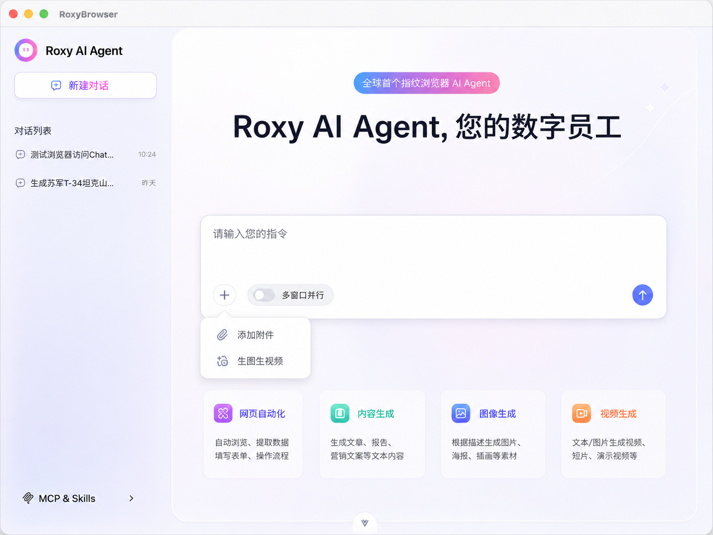
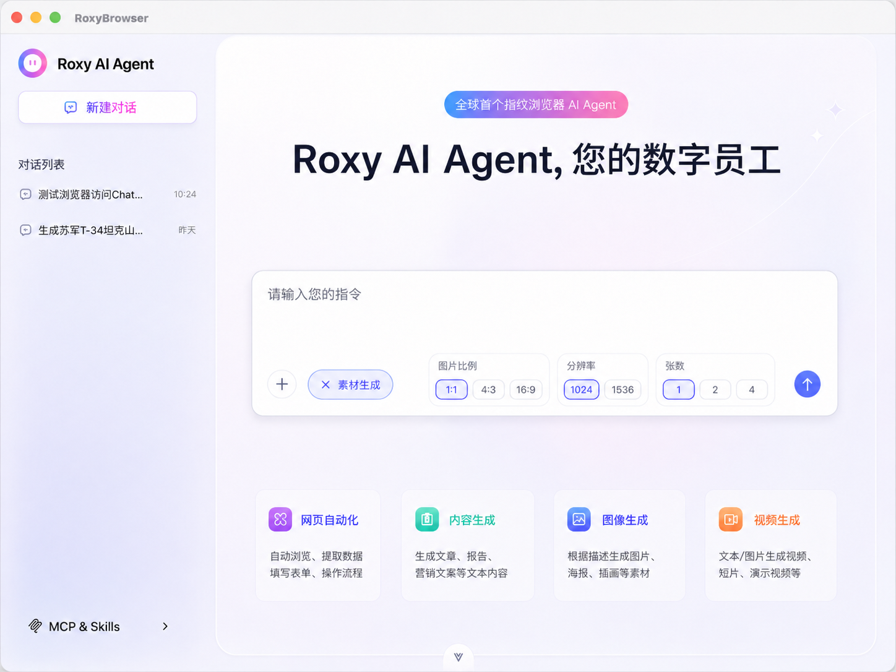

# AIGC Agent 设计方案

## 1. 目标

把图片/视频生成能力从“单独的生图接口”升级为 `roxy-agent` 的原生能力，保持它仍然是**同一个对话 agent**，而不是拆成独立 AIGC agent。

目标能力：

1. 多轮对话中随时可生成图片和视频
2. 能自然引用历史生成内容，例如“修改最开始生成的第三张图片”
3. 能从自然语言中解析数量、尺寸、比例、风格、时长等参数
4. 生成结果可回到同一会话中继续编辑、变体生成、二次创作

## 2. 主流产品范式

### 2.1 ChatGPT

ChatGPT 的主流做法是把图片生成做成**聊天内能力**：

- 用户直接在对话框里发起“Create image”
- 生成与编辑在同一个会话里完成
- 已生成图片会进入单独的图像库，支持回看、复用、再次编辑
- 编辑不是“重新开一个工具页”，而是直接对现有图片发起修改

可借鉴点：

- 生成能力应是对话的一部分，而不是旁路应用
- 已生成资产必须可回溯、可再次引用
- 编辑应支持“基于某张旧图继续改”

### 2.2 Gemini

Gemini 的做法更接近**统一多模态创作工作台**：

- 同一聊天入口同时支持图片生成、图片编辑、视频生成
- 支持上传多张参考图，让模型融合后生成新图
- 视频生成直接由自然语言驱动，不要求用户先理解具体模型名
- 产品层会显式考虑可用性、额度、年龄和地区限制

可借鉴点：

- 图片和视频要共享同一套会话语义
- 参考图、多图融合、编辑、视频生成应使用统一的上下文模型
- 对用户来说是“我想生成/修改/扩展内容”，不是“我要调用某个接口”

### 2.3 火山引擎 Seedream / Seedance

火山引擎公开资料显示，Seedream 已经支持：

- 文生图、图生图、组图生成
- 多图融合创作
- 参考生图与图像编辑
- 4K、多模态输入、主体一致性增强

Seedance 公开资料显示，视频生成也可以被自然语言直接驱动，并且支持脚本、画面匹配、字幕、BGM 等更完整的视频创作流程。

可借鉴点：

- 生成模型本身已经具备“创作工作流”倾向
- 适合把 prompt 规范化和资产引用能力放在 agent 层，而不是只做薄 API 包装

## 3. 现有 roxy-agent 状态

当前代码里已经存在一条独立的图片生成链路：

- `POST /api/images/generations`
- 使用 `doubao-seedream-5-0-260128`
- 支持 `aspectRatio`、`quality`、`count`
- 支持上传附件作为参考图
- 通过 SSE 流式返回单张结果

同时，`POST /api/chat` 已经支持：

- 多轮对话
- 通过 `multimodalAttachments` 传入多模态消息
- 对话和消息落库到 SQLite

但现状的问题是：

1. 图片生成是“旁路能力”，没有进入 agent 的统一工具层
2. 没有“资产索引”，旧图旧视频不能被稳定引用
3. 没有面向自然语言的参数解析层
4. 没有图片/视频的父子派生关系
5. 视频能力还没有纳入同一套会话模型

## 4. 目标架构

```
User
  → /api/chat
  → roxy-agent (same agent)
  → intent/asset resolver
  → multimodal tools
  → provider adapters (Seedream / Seedance)
  → asset registry
  → SSE + conversation history
```

核心原则：

- **一个 agent，多个能力**
- 生成图片/视频只是 agent 的工具之一
- 生成资产必须进入会话历史
- 历史资产必须可检索、可引用、可派生

## 5. 核心设计

### 5.1 能力层

建议把能力拆成 3 类工具：

1. `generate_image`
2. `generate_video`
3. `edit_asset`

其中 `edit_asset` 统一处理：

- 基于旧图改图
- 基于多张旧图融合新图
- 基于视频继续变体生成

### 5.2 资产层

新增”会话资产”概念，不再只把生成结果当成普通消息文件。

这张资产表的职责很单纯：记录每一次生成出来的图片或视频，以及它属于哪个会话、来自哪次生成、排在第几张、是否是某个旧资产的派生结果。

这样”最开始生成的第三张图片”就不需要靠模糊文本猜测，而是可以先锁定会话里的最早批次，再按顺序号定位到第三张。如果同一批里还有多个相似结果，再按生成时间和状态做最终选择。

#### 资产存储服务（待实现）

引入一个独立的**资产存储服务**，统一负责所有生成内容的上传、持久化和访问：

- 图片和视频生成完成后，由 provider 适配层调用资产存储服务上传，返回稳定的访问 URL
- `assets` 表只记录元数据（assetId、url、mimeType、尺寸、时长等），不存储文件本体
- 资产存储服务的具体实现（OSS、CDN、本地文件服务等）对 agent 层透明，通过统一接口调用

```text
provider 生成结果
  → 资产存储服务（上传 + 返回 URL）
  → assets 表（记录元数据 + URL）
  → SSE 推送给前端（携带 URL）
```

资产存储服务的接口形态（待设计）：

```ts
interface AssetStorageService {
  upload(buffer: Buffer, mimeType: string, meta?: Record<string, any>): Promise<{ url: string, fileId: string }>
  getUrl(fileId: string): string
  delete(fileId: string): Promise<void>
}
```

在资产存储服务实现之前，可以继续沿用本地文件存储作为过渡，但 `assets` 表的 URL 字段应从一开始就设计为指向外部服务，而不是本地路径。

### 5.3 参考与派生关系

要支持”修改旧图”，系统需要知道新结果是从哪一个旧结果来的。最轻量的做法不是维护完整知识图谱，而是记录一个简单的派生链：原始资产、派生资产、派生方式。

这样就足够表达几种关键场景：

- 从某一张图继续改
- 从一组图里挑一张继续改
- 用多张参考图合成新图
- 从图片扩展成视频

#### 为什么派生关系对资产检索至关重要

派生关系不只是”记录历史”，它直接影响资产检索的准确性和用户体验。

**场景一：消歧**

用户说”修改上一张图”，会话里可能同时存在：
- 第一批生成的 4 张图（原始资产）
- 对其中第 2 张做过一次编辑（派生资产）
- 对编辑结果又做了一次风格调整（二级派生）

如果没有派生关系，检索”上一张图”只能按时间倒序，结果可能是二级派生，也可能是原始批次里的某张，无法区分。有了派生链，检索器可以优先返回”最近一次可编辑的叶节点资产”，而不是随机命中。

**场景二：编辑链路追踪**

用户说”回到最开始的版本重新改”，需要沿派生链向上追溯到根节点（原始资产）。没有派生关系，这个操作无法实现，只能让用户自己翻历史消息找图。

**场景三：多图融合的来源还原**

用户说”用刚才那两张图再融合一次，但换个风格”，系统需要知道”那两张图”是哪次融合操作的输入。派生关系里记录了 `source_asset_ids`（多个来源），检索器可以直接还原上一次融合的输入集合，不需要用户重新指定。

**场景四：避免循环引用**

如果 A 派生出 B，B 又被用来生成 C，派生链能防止系统在”基于 C 修改”时错误地把 A 或 B 当成编辑目标，也能在展示派生树时正确渲染层级关系。

**总结**：派生关系是资产检索的”导航索引”。没有它，检索只能依赖时间和序号，面对复杂的多轮编辑场景会频繁出错；有了它，检索器可以沿着创作脉络精确定位，agent 也能在追问用户之前先做一次有把握的自动推断。

### 5.4 自然语言参数解析

agent 不应该把“3张 4K 横图”这种输入直接原样丢给 provider。正确做法是先把用户话里的要求统一成一个内部意图，再把这个意图交给后续生成流程。

这个意图里至少要包含几类信息：

- 数量
- 比例
- 分辨率
- 时长
- 风格
- 主体
- 参考图来源
- 编辑目标

换句话说，用户输入先被理解成“我要做什么、对象是谁、要多少、什么尺寸、什么风格、是否依赖旧资产”，然后再进入实际生成。

### 5.5 资产引用解析

用户引用历史资产时，通常不会说资产 ID，而是会用时间、顺序、上下文、内容、风格来描述目标。例如：

- “之前的图”
- “上一轮生成的第二张”
- “刚才那张”
- “赛博朋克风格的那张”
- “背景是雪山风景的图片”
- “把上次改过的那张继续换成蓝色调”

这些表达不能直接当成搜索词。正确流程是先识别用户到底在引用什么，再把引用意图转换成可执行的搜索请求。

```text
用户输入
  → 识别生成/编辑/引用意图
  → 提取顺序线索、内容线索、风格线索、派生线索
  → 生成资产搜索请求
  → 召回候选资产
  → 按规则和 BM25 分数排序
  → 返回唯一资产或发起澄清
```

#### 5.5.1 输入表达的类型

用户自然语言里的资产定位线索可以分成四类。

第一类是顺序定位。比如“之前的”“上一轮”“刚才”“最开始”“最后一张”“第三张”。这类表达应优先映射到生成批次、批次内顺序、最近编辑链路和创建时间。

第二类是内容定位。比如“背景为雪山风景的”“有两个人的”“红色车的”“带 logo 的”。这类表达应优先匹配资产生成 prompt、用户后续编辑描述和已有内容摘要。视觉模型生成摘要只作为后续异步增强，不进入第一版主链路。

第三类是风格定位。比如“xx 风格的”“赛博朋克那张”“水彩风格”“写实风格”。这类表达应匹配风格标签、prompt 中的风格词、生成参数和资产内容摘要。

第四类是派生定位。比如“上次改过的”“从第一张改出来的”“刚才融合的那两张”“回到原图重新改”。这类表达必须依赖资产派生关系，否则只能按时间猜测。

#### 5.5.2 意图识别到搜索请求

意图识别不应该只输出关键词，而应该输出一组搜索约束。

如果用户说“上一轮生成的第二张”，搜索请求应包含：

- 当前会话
- 图片资产
- 上一轮生成批次
- 批次内第 2 个结果

如果用户说“雪山背景那张”，搜索请求应包含：

- 当前会话
- 图片或视频资产
- 内容关键词：雪山、背景、风景
- 优先匹配内容摘要和 prompt

如果用户说“把刚才改过的那张换成水彩风格”，搜索请求应包含：

- 当前会话
- 最近一次编辑链路
- 优先选择派生链的叶子节点
- 新的编辑意图：水彩风格

如果用户说“用刚才融合的两张图再生成一次”，搜索请求应包含：

- 当前会话
- 最近一次融合操作
- 返回该融合操作的来源资产集合，而不是只返回融合后的结果

#### 5.5.3 搜索请求维度与资产表数据

搜索请求至少需要覆盖以下维度：

| 维度 | 作用 | 资产表是否需要保存 |
| --- | --- | --- |
| 会话范围 | 限定只搜索当前会话或指定会话 | 需要 |
| 资产类型 | 区分图片、视频、任意资产 | 需要 |
| 时间顺序 | 支持“刚才”“之前”“最开始” | 需要 |
| 生成批次 | 支持“上一轮”“这组图” | 需要 |
| 批次内编号 | 支持“第三张”“最后一张” | 需要 |
| 派生关系 | 支持“改过的”“原图”“融合来源” | 需要 |
| 内容描述 | 支持按主体、背景、元素搜索 | 建议保存，可先从 prompt/编辑指令提取 |
| 风格描述 | 支持按风格、色调、质感搜索 | 需要 |
| 生成参数 | 支持按尺寸、比例、时长搜索 | 需要 |
| 用户原始 prompt | 支持语义召回和解释命中原因 | 需要 |

因此，资产表只保存 URL 是不够的。它还需要保存可搜索的元数据：生成 prompt、风格标签、内容摘要、生成参数、批次信息、顺序编号、派生来源、创建时间等。

其中“内容描述”和“风格描述”第一版不需要依赖视觉模型，可以先从用户 prompt、编辑指令和生成参数中抽取。后续如果需要更高准确率，再异步使用视觉模型补充内容摘要，不能阻塞用户请求。

#### 5.5.4 定位优先级

资产定位应优先走确定性路径，只有确定性路径无法命中时才启动搜索。

```text
用户输入
  → 是否能按批次 / 序号 / 派生链 / 最近上下文直接定位？
      → 是：直接返回资产
      → 否：进入关键词搜索
```

可以直接定位的典型表达包括：

- “上一轮生成的第二张”
- “最开始的第三张”
- “刚才那张”
- “刚刚改过的版本”
- “回到原图”

这些表达本质上不是搜索问题，而是结构化引用问题。系统应直接查询资产表中的批次、序号、时间和派生关系，不需要额外跑文本检索。

#### 5.5.5 搜索与排序

只有当用户通过内容或风格描述定位资产时，才启动搜索。例如：

- “雪山背景那张”
- “赛博朋克风格的图”
- “蓝色调的视频”
- “带 logo 的版本”

搜索建议使用“结构化过滤 + BM25/全文检索 + 简单加权排序”。第一版不引入 embedding、LLM rerank 或同步视觉模型，因为这些能力会增加响应延迟和实现复杂度。

搜索流程：

1. 结构化过滤
   - 先按会话、资产类型、时间范围、派生关系缩小候选集

2. BM25/全文检索
   - 在 prompt、风格标签、内容摘要、编辑描述组成的搜索文本中检索关键词

3. 简单加权排序
   - 精确字段命中优先
   - 风格标签命中优先于普通 prompt 命中
   - 时间更接近当前上下文的候选优先
   - BM25 分数作为主要文本相关性依据

建议的打分优先级：

```text
强规则命中（批次、序号、派生链）
  > 时间和上下文接近度
  > 风格标签精确命中
  > BM25 文本相关性
  > 默认最近资产
```

如果最高分明显高于其他候选，就直接命中；如果前几个候选分数接近，agent 应该追问，例如：“你是指刚才生成的雪山背景图，还是上一轮第二张蓝色调图片？”

embedding、LLM rerank 和视觉模型可以作为未来增强，但原则上应放在异步或可选路径里，不进入第一版同步请求链路。

### 5.6 UI 部分针对优化

下方的图片仅作参考，不代表具体的 UI 设计方案，主要用于表达功能调整的具体方向。

#### 5.6.1 取消独立的“生图生视频”标签选择

取消“网页自动化”和“生图生视频”的 Tab 栏选择，改为添加一个 “+” 按钮用于向 agent 添加对应能力。



#### 5.6.2 图片规格选项

使用图片规格的相关选项（图片比例、分辨率、张数等参数）代替原有的“多窗口并行”：



此处的选项将会直接映射到图片生成工具的相关参数。同时各种选项应该提供“自动”选项作为默认，允许用户使用自然语言指定图片规格。如果自然语言规格和选中的参数同时存在，**下方选中的参数优先级更高**。

## 6. 路由与消息流改造

### 6.1 统一入口

建议保留 `/api/chat` 为唯一用户入口。

图片和视频生成不要再作为“独立产品入口”，而是由 agent 在聊天流程中触发工具调用。

### 6.2 SSE 事件扩展

现有 `image_generating` / `image_partial` 只能覆盖图片。

建议扩展为：

- `asset_generating`
- `asset_partial`
- `asset_completed`
- `asset_updated`
- `asset_resolved`

这样前端可以统一处理图片和视频。

### 6.3 消息落库

对话消息建议保留原有 `messages` 表，但生成资产单独入表。

普通 assistant 消息只负责：

- 解释结果
- 引导后续操作
- 记录生成摘要

资产本体交给 `assets` 表。

## 7. provider 适配

### 7.1 图片

继续沿用 Seedream 适配，但建议统一封装为：

- `prepareImageGenerationRequest`
- `prepareImageEditRequest`
- `persistGeneratedAsset`

### 7.2 视频

视频建议单独抽适配层，不和图片共用一个 payload 结构。

即使底层都来自火山系能力，也要在 agent 层把“图片参数”和“视频参数”拆开：

- 图片：count / ratio / resolution / reference image / edit instruction
- 视频：duration / ratio / motion / scene / reference image / script

### 7.3 输出标准化

所有 provider 最终都要归一为：

```ts
{
  assetId: string
  assetType: 'image' | 'video'
  url: string
  fileId: string
  mimeType: string
  width?: number
  height?: number
  duration?: number
  prompt: string
  source: string
}
```

## 8. 落地路径

### Phase 1

- 把现有图片生成逻辑迁入 agent 工具层
- 保留原路由作为兼容包装
- 增加结构化参数解析

### Phase 2

- 新增资产表
- 记录生成批次、顺序、父子关系
- 支持“第几张图”的引用解析

### Phase 3

- 接入视频生成工具
- 统一 SSE 事件
- 前端显示资产卡片与派生链路

### Phase 4

- 支持旧资产编辑、融合、多图引用
- 引入更完整的会话摘要，保证长会话中的资产可发现性

## 9. 风险与约束

1. 仅靠 prompt 不足以稳定指代历史资产，必须有结构化索引
2. 视频生成通常比图片慢，SSE 和任务状态必须独立
3. 批量生成时，顺序、编号、完成态都要持久化
4. 多模态上下文会增长很快，必须做会话摘要和资产裁剪
5. 如果 provider 不支持真正编辑，就要在 agent 层把“编辑”降级为“基于参考图重新生成”

## 10. 建议结论

roxy-agent 的最佳方向不是新开一个 AIGC agent，而是把 AIGC 做成它的**原生多模态技能集**。

也就是说：

- 会话还是同一个
- Agent 还是同一个
- 能力变成图片/视频/编辑/引用历史资产的一体化工作流

这会比“单独起一个 AIGC agent”更符合当前仓库结构，也更符合 ChatGPT、Gemini、Seedream 这类产品的主流做法。

## 11. 代码层面实施细节

这一节只列代码落点，不再解释设计原理。

### 11.1 路由与服务

- `packages/roxy-agent/src/server/chatRoutes.ts`
  - 把 `POST /api/images/generations` 收敛为 agent 工具调用的兼容层
  - 在 `POST /api/chat` 内加入 AIGC 意图识别与资产引用解析
  - 给 `asset_generating`、`asset_partial`、`asset_completed`、`asset_resolved` 预留 SSE 输出
- `packages/roxy-agent/src/server/streamAdapter.ts`
  - 增加统一的资产事件类型
  - 保留现有图片事件作为过渡兼容
- `packages/roxy-agent/src/server/index.ts`
  - 不改入口形态，只接入新路由能力

### 11.2 资产与会话存储

- `packages/roxy-agent/src/database/conversations/index.ts`
  - 保持现有 `conversations` / `messages` 表不变
  - 新增 `assets` 相关表和索引
  - 增加资产批次、父子关系、序号和检索字段
- `packages/roxy-agent/src/database/conversations/types.ts`
  - 增加 `Asset`、`AssetSearchRequest`、`ResolvedAssetReference` 等类型

建议 `assets` 至少包含这些字段：

- 基础字段：`id`、`conversation_id`、`message_id`、`asset_type`、`url`、`file_id`、`mime_type`、`status`
- 顺序字段：`batch_id`、`batch_index`、`ordinal_in_batch`、`created_at`
- 派生字段：`parent_asset_id`、`source_asset_ids`、`relation_type`、`root_asset_id`
- 参数字段：`width`、`height`、`aspect_ratio`、`quality`、`duration`
- 检索字段：`prompt`、`edit_instruction`、`style_tags`、`content_summary`、`search_text`
- 扩展字段：`metadata`

索引建议：

- `conversation_id + created_at`
- `conversation_id + batch_id + ordinal_in_batch`
- `conversation_id + asset_type`
- `parent_asset_id`
- `root_asset_id`
- `relation_type`

如果 SQLite 构建支持 FTS5，可以给 `search_text` 建全文索引；如果当前运行环境不稳定支持 FTS5，则先用普通文本匹配作为过渡。

### 11.3 Agent 工具层

- `packages/roxy-agent/src/deepagents/tools/`
  - 新增 `generate_image`
  - 新增 `generate_video`
  - 新增 `edit_asset`
  - 新增 `resolve_asset_reference`
- `packages/roxy-agent/src/deepagents/prompt/index.ts`
  - 把资产引用、编辑、数量、比例、时长的自然语言规范写进系统提示词

`resolve_asset_reference` 建议拆成三个内部步骤：

1. `parseAssetReferenceIntent`：从用户输入中提取顺序、内容、风格、派生、动作意图
2. `buildAssetSearchRequest`：把意图转换成数据库可执行的搜索约束
3. `resolveAssetCandidates`：先确定性定位，必要时执行 BM25 搜索、排序、消歧

不要让 LLM 直接返回资产 ID。LLM 只负责辅助理解用户表达，最终资产 ID 必须由本地资产表检索产生。

### 11.4 Provider 适配

- `packages/roxy-agent/src/server/chatRoutes.ts`
  - 保留 seedream 请求构造逻辑
  - 新增视频生成请求构造
  - 把生成结果统一落为资产记录
- 需要时再拆出独立适配文件，例如：
  - `packages/roxy-agent/src/providers/aigc/image.ts`
  - `packages/roxy-agent/src/providers/aigc/video.ts`

### 11.5 事件和数据流

建议最终链路保持为：

```text
用户输入
  → 资产引用解析
  → 确定性定位（批次 / 序号 / 派生链）
  → 必要时 BM25 搜索
  → 资产命中或消歧
  → 生成/编辑工具调用
  → provider
  → 资产持久化
  → SSE 事件
  → 对话历史
```

### 11.6 资产搜索实现

建议新增模块：

- `packages/roxy-agent/src/aigc/assetReference.ts`
- `packages/roxy-agent/src/aigc/assetSearch.ts`
- `packages/roxy-agent/src/aigc/assetRerank.ts`
- `packages/roxy-agent/src/aigc/types.ts`

搜索实现分三层：

1. 确定性定位
   - 使用会话、资产类型、批次、顺序编号、派生关系、时间范围直接定位
   - 负责处理“刚才”“上一轮”“第三张”“原图”“改过的”这类表达
   - 命中唯一资产时直接返回，不进入搜索

2. BM25/全文检索
   - 使用 `search_text` 搜索 prompt、内容摘要、风格标签、编辑指令
   - 负责处理“雪山背景”“赛博朋克风格”“蓝色调”这类表达
   - 仅在确定性定位无法命中时触发

3. 简单加权排序
   - 精确字段命中优先
   - 风格标签命中优先于普通 prompt 命中
   - 时间和上下文距离次之
   - BM25 分数作为文本相关性的主要依据

第一版不引入 embedding、LLM rerank 或同步视觉模型。视觉模型生成内容摘要可以作为异步增强，写回 `content_summary` 和 `search_text`，但不能阻塞本轮用户请求。

搜索结果需要包含命中原因，方便 agent 向用户解释或追问。

### 11.7 最小改动顺序

1. 先把资产引用解析单独实现
2. 再加资产表和索引
3. 再把图片生成挂进 agent 工具层
4. 再扩视频生成
5. 最后统一 SSE 事件和前端展示

## 参考资料

- OpenAI: [Creating images in ChatGPT](https://help.openai.com/en/articles/8932459-creating-images-in-chatgpt)
- OpenAI: [ChatGPT Images FAQ](https://help.openai.com/en/articles/11084440-chatgpt-image-library)
- OpenAI: [GPT Image API](https://help.openai.com/en/articles/11128753)
- Google: [Generate & edit images with Gemini Apps](https://support.google.com/gemini/answer/14286560)
- Google: [Generate videos with Gemini Apps](https://support.google.com/gemini/answer/16126339)
- Volcano Engine: [图片生成编辑（豆包seedream系列模型）](https://www.volcengine.com/docs/6492/2221472)
- Volcano Engine: [Seedance 2.0全面开放API服务](https://developer.volcengine.com/articles/7628567056649125942)
